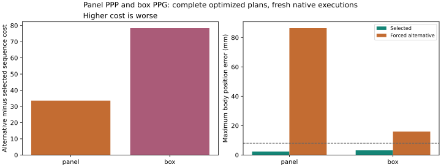
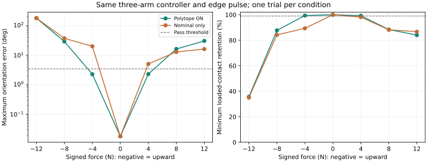

# 접촉 유형·source robustness 비교와 현재 알고리즘 범위

2026-11-12. [기계 판독 결과](algorithm-comparison-results.json)와 웹의
「다른 유형·robustness ON/OFF 비교」에서 전체 조건을 확인할 수 있습니다.
기존 세 과제의 원방법과 21개 비교 기록은 보존했습니다.

## 다른 접촉 유형으로 전체 과제를 다시 계획·실행

같은 source refinement, 물체·로봇 물성, 기능 접촉 후보, 물리 팔 배정 `(0,1,2)`,
solver 설정과 제어기를 사용하고 유형만 강제로 바꿨습니다. 이전 비용 하한 가지치기를
넘어 대안 후보의 모든 keyframe과 전이를 실제로 계산했습니다. 실패 iterate는 실행하지
않으며, 수락된 계획만 native MuJoCo로 실행했습니다.

| 과제 | 선택 / 강제 대안 | 전체 시퀀스 목적값 | 대안의 실제 결과 |
|---|---|---|---|
| 패널 | G/P/P → P/P/P | −64.1251 → −30.5814, **+33.5436** | 계획 통과, 물리 실행 FAIL: 최대 위치 오차 86.39 mm, edge 접촉 유지 45.67% |
| 박스 | G/P/G → P/P/G | −124.6974 → −46.3402, **+78.3572** | 계획 통과, 물리 실행 FAIL: moving-link 최대 위치 오차 15.95 mm, 본체 point 접촉 유지 93.47% |
| 조립 | G/P/G → G/P/P | 대안의 수락된 시퀀스 없음 | 계획 단계 탈락: 독립 free leg의 P 하나는 최대 rank 3으로 요구 rank 6 wrench image를 지지하지 못함 |

목적값은 원래의 geometry/posture−rho 및 전이 비용 합이며 작을수록 좋습니다.
에너지 사용량으로 해석하지 않습니다. 같은 초기화·budget에서의 실행 결과이며 다른 IK,
제어기나 모든 가능한 궤적에 대한 전역 불가능 증명은 아닙니다. 특히 P/P/P는 계획 수식의
독립 잔차 검사를 통과했지만 현재 제어기·접촉 실행에서는 실패했습니다.



## 같은 접촉 물질점과 물체 자세의 독립 용량 비교

추가로 선택된 물질점과 한 keyframe의 물체 자세를 고정하고 유형별 실제 공구의 IK,
native collision, SOCP 반력·토크 한계를 다시 계산했습니다. 모든 후보가 같은 (E,D)와
posture reference를 사용합니다. 이 값은 전체 시퀀스 비용과 구분합니다.

| 과제 | 선택 유형의 최대 ρ | 대안의 최대 ρ |
|---|---:|---|
| 패널 | G/P/P: 8.2500 | P/P/P: 3.0240 |
| 박스 | G/P/G: 15.1506 | P/P/G: 5.6380, G/P/P: 0.9509; P/P/P는 frozen-keyframe 검사 탈락 |
| 조립 | G/P/G: 8.0136 | 나머지 허용 유형은 frozen-keyframe 검사 탈락 |

각 표본의 상태·잔차, 공통 ρ=0.1에서의 peak joint torque와 최소 토크 여유도 JSON에
포함합니다. 다른 rho에서의 힘 크기를 그대로 비교하면 서로 다른 외력 집합을 검사하게
되므로, 공통 하중 집합의 물리량과 최대 용량을 구분했습니다. 과제별 (E,D)가 다르므로
서로 다른 과제의 rho를 직접 순위로 비교하지 않습니다.

## Source polytope ON/OFF: 별도의 세 팔 패널 지지 실험

이 실험은 III-B의 효과를 분리하는 정지 지지 diagnostic입니다. 세 Panda와 동일한
165 mm spherical tool 3개, 2 kg 자유 패널을 사용합니다. Gripper, jig, object actuator,
mocap 또는 object weld는 없습니다. 초기 contracted contact는 주어진 synthetic 입력입니다.
소형 source는 길이 1/4, 질량 1/64이며 P 힘 한계도 명시적으로 1/64로 정의했습니다.
이 스케일 규칙을 일반적인 하드웨어 정격 법칙으로 주장하지 않습니다.

두 조건 모두 같은 surface patch, 법선, 이동 반경 32.5 mm(source), 마찰, 법선 힘
한계와 geometry weight γ=1000 m⁻²를 사용합니다.

```math
\begin{aligned}
\text{ON:}\quad&\min\ \gamma\sum_i\|p_i-\hat p_i\|^2-\rho,\\
&\sum_iG_i(p_i)f_i^v=w_g+\rho E_sD_sv,\quad v\in\{-1,+1\}^3,\\
\text{OFF:}\quad&\min\ \gamma\sum_i\|p_i-\hat p_i\|^2,\\
&\sum_iG_i(p_i)f_i=w_g.
\end{aligned}
```

양쪽 모두 contact force cone과 정상 하중 지지 제약을 유지합니다. OFF는 rho 항과
교란 vertex만 제거한 명목 평형 최적화입니다. 이는 공통 geometry regularizer를 가진
통제 실험이며, geometry weight가 0인 원고 Eq. (7)의 순수 max-rho 목적과 구분합니다.

미리 고정한 작용점은 target body 좌표 `r=[0,0.18,0.02] m`이며

```math
E_s=\begin{bmatrix}S(r/4)\\I_3\end{bmatrix},\quad
D_s=\operatorname{diag}(2.56,2.56,8)/64,\qquad
E_t=J_p(q)^T,\quad D_t=\operatorname{diag}(2.56,2.56,8).
```

따라서 같은 점에 작용하는 3차원 force box의 8개 vertex를 검사합니다. 임의의
6차원 wrench 전체를 검증한 실험은 아닙니다. (E,D)를 결과에 맞춰 조정하지 않았습니다.
정련된 접촉 위치만 4배 전달하고 target 반력·토크를 다시 풉니다. 효과 분리를 위해
target 물질점은 전달된 위치에 고정하고 로봇 자세·힘·토크는 양쪽 모두 재최적화합니다.

동일한 독립 검산에서 source/target margin은 OFF **0.376811**, ON **0.597848**입니다.
힘 조건마다 각 mode의 case/plan ID가 동일하고, ON/OFF의 controller configuration도
동일함을 요약 도구가 검사합니다. 실제 팔 제어는 기존 `impedance_feedforward`, Sf=0,
joint nullspace K=40/D=8이며 native timestep은 1 ms입니다.

실제 외력은 world `(0,0,-F)` 방향으로 4–5 s의 1초 sin² pulse입니다. F가 음수이면
위쪽입니다. 0, ±4, ±8, ±12 N을 각 mode에서 1회씩, 총 14회 검사했습니다. 방향·크기·
작용점·시간·판정 기준을 바꾸거나 ON만 다른 controller로 실행하지 않았습니다.

| 외력 | ON | OFF |
|---|---|---|
| 0 N | PASS | PASS |
| 4 N 위 | PASS: 최대 1.624 mm / 0.03970 rad / 접촉 99.39% | FAIL: 15.242 mm / 0.35039 rad / 접촉 89.37% |
| 4 N 아래 | PASS: 최대 1.556 mm / 0.04004 rad / 접촉 99.24% | FAIL: 1.816 mm / 0.08863 rad / 접촉 98.12% |
| 8 N 위·아래 | FAIL | FAIL |
| 12 N 위·아래 | FAIL | FAIL |

4 N의 normalized force coefficient 0.5는 ON box 안, OFF box 밖입니다. 8/12 N은
ON box도 벗어나며, 강건성 효과가 모든 크기에서 항상 더 작은 오차를 준다고 주장하지
않습니다. 4 N OFF 실행도 외력 제거 뒤에는 회복합니다. 여기서 확인한 실패는 외력 중
접촉 손실과 자세 기준 위반이며, 영구 붕괴나 수학적인 폐루프 불안정성 증명이 아닙니다.



## 현재 구현이 원고 알고리즘 전체와 동일한가

**아직 원고 그대로의 완전 검증이라고 부르지 않습니다.** 실제로 연결된 범위는 supplied
contracted groups → source refinement → target force/torque realization → 허용된 유형·
팔 배정 탐색 → 제한 접촉 후보의 모든 전이 최적화 → 제어기 → MuJoCo 동역학입니다.

- 학습 network와 실제 시연 contraction은 실행하지 않고 contracted group을 입력받습니다.
- 기존 박스·조립 source solve의 fallback은 원고에 명시된 경로이며, source robustness
  certificate 성공으로 집계하지 않습니다.
- 원고 Eq. (17) 그대로의 poststep 적분 대신 independent/contact-coordinate midpoint
  변형을 사용합니다. 환경·접촉 모드 후보도 현재 과제에 제한되어 있습니다.
- 통과 기록의 팔 제어는 planned reaction FF＋impedance이며 Sf=0입니다. 측정 normal-force
  hybrid arm feedback이 통과했다고 주장하지 않습니다. Gripper jaw force feedback은 별도입니다.
- 새 전체 과제는 세 Panda로 검증했습니다. RB5/RBY1/G1의 전체 알고리즘·하드웨어 적용과
  새 과제의 CRISP 교차 검증 결과는 아닙니다.

이 구분은 웹과 JSON의 `full_paper_pipeline_executed=false`에도 유지됩니다. 추가 실험은
현재 구현의 접촉 유형 및 source robustness 효과를 지지하지만 위 미완성 범위를 없애지는 않습니다.

## 재현과 코드 경로

```bash
OPENBLAS_NUM_THREADS=1 .venv/bin/python tools/run_source_robustness_study.py
OPENBLAS_NUM_THREADS=1 .venv/bin/python tools/run_type_counterfactual.py \
  --task panel --types PPP --archive outputs/full_scenarios_v22/panel/full/planning
OPENBLAS_NUM_THREADS=1 .venv/bin/python tools/run_type_counterfactual.py \
  --task box --types PPG --archive outputs/full_scenarios_v22/box/full/planning
OPENBLAS_NUM_THREADS=1 .venv/bin/python tools/run_type_counterfactual.py \
  --task assembly --types GPP --archive outputs/full_scenarios_v15/assembly/full/planning
OPENBLAS_NUM_THREADS=1 .venv/bin/python tools/compare_type_capacities.py
OPENBLAS_NUM_THREADS=1 .venv/bin/python tools/summarize_algorithm_comparisons.py
MPLCONFIGDIR=/tmp/contact-comparison-mpl .venv/bin/python tools/plot_algorithm_comparisons.py
```

Raw traces와 controller logs는 각 output의 `native/`에 있으며 compact 결과·도표는 이
저장소와 웹에 포함합니다. `refinement.py`는 기본 ON 동작을 유지하며 nominal-only
ablation을 명시적으로 선택할 때만 vertex를 제거합니다. `robustness_study.py`가 분리
실험의 모델·최적화·native 실행을 구성하고 `full_pipeline.py`의 forced candidate 경로가
다른 유형을 전체 planner에 통과시킵니다. 원래 21조건과 새 14조건/강제 유형 비교는
별도로 집계합니다.

기존 output이 없는 환경에서는 `--archive`를 생략해 keyframe부터 새로 풉니다.
Archive를 제공해도 원래의 formulation/model·trust region·force mode와 독립 mechanics
검사를 통과해야 재사용하며, 재사용한 단계를 새 solve 시간으로 집계하지 않습니다.
