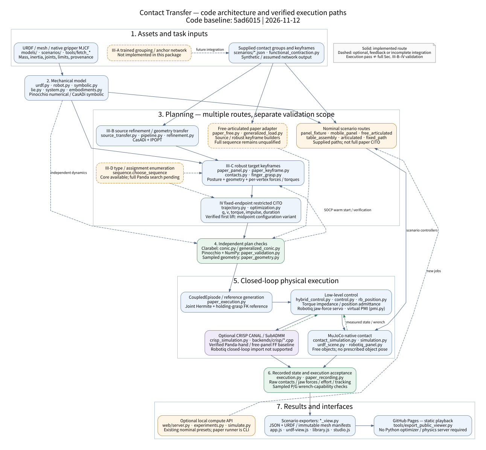
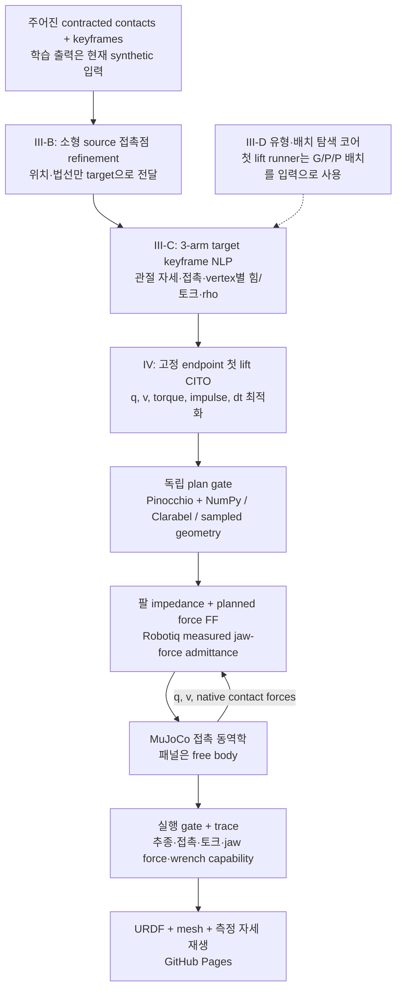

# 전체 코드 구조 및 개선·solver 구성 보고

기준일: **2026-11-12**. 구현 기준은 `feat/conic-contact-validation`의
**`5ad6015`**이며, 이 보고서 작성에 따른 문서 변경은 별도입니다.
공개 뷰어 기준은 `Contact_contraction/main`의 **`52b561a`**입니다.

현재 완료한 실행은 **실제 Robotiq 2F-85를 장착한 3-Panda G/P/P 시스템의
source refinement → target keyframe 최적화 → 첫 lift 구간 CITO 변형 →
MuJoCo 접촉 실행 → 독립 검산 → 웹 배포**입니다.
전체 재배향·지그 안착·릴리스, III-D의 접촉 유형/팔 배치 비교,
모든 모바일·articulated 과제의 Sec. III-B–IV 연결까지 완료한 상태는 아닙니다.

## 1. 전체 구조도



[구조도 원본 DOT](../diagrams/system-architecture.dot). 재생성 명령:

```sh
dot -Tsvg docs/diagrams/system-architecture.dot -o docs/images/system-architecture.svg
```

구조도에서 중요한 구분은 **논문 최적화 경로**와 **기존 명목 경로 기반 시나리오**입니다.
같은 URDF·동역학·시뮬레이션 부품을 공유하지만, 기존 모바일/조립 영상이 새 논문 경로를
자동으로 실행하는 구조는 아닙니다. 점선은 선택 기능, 피드백 또는 아직 통합이 남은 연결입니다.

### 실제 실행되는 첫 lift의 데이터 흐름



여기서 G는 gripper, P는 spherical point contact입니다. 두 P가 아래에서 지지하고
하나의 G가 edge를 파지합니다. 목표 패널은 0.6 × 0.4 × 0.04 m, 2 kg이고,
소형 source 형상의 각 길이는 1/4입니다. Source 힘을 4배/64배 하는 처리는 없습니다.
Target 하중과 로봇 한계로 힘·토크를 다시 계산합니다.

## 2. 코드 디렉터리와 모듈의 책임

```text
scale-aware-contact-transfer/
├── src/contact_transfer/       Python mechanics / planning / control / execution
│   ├── models/                8종 embodiment의 mechanics URDF, metadata, licenses
│   │   └── robotiq_2f85/       pinned native source 및 선언된 simulation 설정
│   └── scenarios/             robot/tool/object URDF, contact/keyframe JSON, licenses
├── backends/crisp/             별도 설치 CRISP SDK에 연결하는 자체 C++ client
├── tools/                      모델 fetch, 시나리오 준비, 논문 runner, 검산, 정적 export
├── examples/                   수식·solver·grasp discretization 재현 예제
├── tests/                      mechanics, optimization, controller, scene/trace 검사
├── web/
│   ├── src/                   Three.js UI, URDF loader, 실험 분류, 조명
│   ├── data/                  공개 가능한 실행 JSON
│   ├── models/                viewer URDF, mesh manifest, upstream licenses
│   ├── server.py              선택적인 로컬 계산 HTTP API
│   ├── experiments.py         기존 시나리오 job 생성·상태·취소
│   ├── simulate.py            단일 embodiment 시뮬레이션
│   └── tests/                 브라우저 회귀 검사
├── docs/                      수식 대조, 구현 경계, 구조도와 저장된 검증 결과
├── outputs/                   로컬 plan/trace/log; Git 배포의 원본 전체는 아님
└── .cache/                    upstream mesh와 별도 SDK; 공개 배포 대상 아님
```

| 계층 | 주요 모듈 | 책임 및 호출 관계 |
|---|---|---|
| 기계 모델 | `urdf`, `robot`, `symbolic`, `lie`, `system`, `embodiments`, `__init__` | URDF를 읽어 수치/기호 M, bias, gravity, FK/J, 적분과 다중 로봇·물체 시스템 구성 |
| 접촉 모델 | `contacts`, `finger_grasp`, `tool_physics` | P/G/S capability, friction cone, gripper finger resultant, tool 접촉 물성 |
| Source | `functional_contraction`, `pipeline`, `source_transfer`, `refinement` | 주어진 group 내 contraction, source surface refinement, geometry-only transfer. 학습 grouping은 외부 입력 |
| Target·검산 | `realization`, `paper_keyframe`, `generalized_load`, `conic`, `generalized_conic` | 자세·접촉·vertex 힘/토크의 robust NLP와 고정 형상의 Clarabel 검산 |
| 경로·유형 선택 | `sequence`, `trajectory`, `fixed_path`, `ik`, `optimization` | 후보 열거, restricted CITO, 주어진 경로의 힘 배분, IK, 공통 NLP 설정·실패 진단 |
| 시나리오 | `contracted`, `three_arm`, `panel_fixture`, `table_assembly`, `mobile_panel`, `articulated`, `free_articulated` | 기존 Cartesian/Panda/모바일/조립/수동 관절 명목 시나리오 |
| 논문 어댑터 | `paper_panel`, `paper_free` | 패널 논문 경로와 자유 articulated 물체의 일반화된 source/keyframe problem builder |
| 저수준 제어 | `control`, `hybrid_control`, `rb_position`, `pmi`, `paper_execution` | torque/position 인터페이스, hybrid 선택, nullspace impedance, virtual PMI, reference·실행 루프 |
| Robotiq | `robotiq`, `robotiq_panel` | native MJCF→tree URDF 변환/검산, clamp, force servo, Panda mount와 내부 기구 제약 |
| 시뮬레이션 | `simulation`, `urdf_scene`, `contact_simulation`, `crisp_simulation`, `perturbations` | MJCF 생성, native engine 제어·관측, CRISP bridge, 실제 외력 주입 |
| 기록·판정 | `execution`, `paper_recording`, `paper_validation`, `paper_geometry` | portable NPZ, 모델/계획 식별, 수치 동역학 검산, 샘플링 충돌 검사 |
| 내보내기 | `assembly_view`, `articulated_view`, `free_articulated_view`, `mobile_view`, `panel_view`, `paper_view`, `robotiq_view`, `three_arm_view` | 각 시나리오의 측정 상태를 JSON·URDF manifest로 변환 |
| 진입점 | `cli`, `tools/run_paper_panel.py`, `tools/run_robotiq_clamp.py` | 일반 CLI, 논문 첫 lift, native 그리퍼 요소 시험 |

위 표는 현재 package의 58개 최상위 Python 모듈을 책임별로 묶은 것입니다.
공통 이름의 `plan_*` 함수라도 fixed-path 힘 최적화와 CITO의 관절·물체 경로 탐색은 구분해야 합니다.
흡착 도구는 기존 `tool_physics`와 three-arm 요소 예제에 포함되지만, 이번 새 논문 첫 lift는
G/P/P 배치이며 suction 타입의 Sec. III-D/IV 전체 검증을 추가한 결과는 아닙니다.

## 3. Solver 구성: 무엇이 바뀌었는가

**주 NLP solver를 다른 solver로 교체하지 않았습니다.** CasADi + IPOPT를 유지하면서,
고정 형상 검산, 초기화, 제약 표현, 적분 방식의 선택, 제어와 접촉 실행을 보강했습니다.

| 도구 | 현재 역할 | 실행/검증 상태 |
|---|---|---|
| CasADi 3.7.2 | symbolic dynamics, 자동미분, 목적함수·제약과 NLP 구성 | source/keyframe/CITO에 사용 |
| IPOPT 3.14.11 | source refinement, target robust NLP, CITO 풀이 | 주 solver 유지. 확인한 기본 linear solver는 MUMPS 5.4.1 |
| Clarabel 0.11.1 | 고정 geometry/posture의 SOCP margin 및 grasp-wrench feasibility | 독립 검산과 NLP warm start에 사용. 전체 접촉/자세/모드 탐색의 대체 solver는 아님 |
| SNOPT | `SolverSettings.backend`와 제한 benchmark 선택지 | 인터페이스만 준비. 검증 runtime에서 unavailable, 성능 우위 결과 없음 |
| Pinocchio 4.1.0 + NumPy | native M/bias/J/RNEA 및 접촉 변환의 독립 계산 | IPOPT가 푼 symbolic 식을 그대로 재평가하는 검사와 구분 |
| MuJoCo 4.0.0 | articulated robot와 자유 물체의 접촉 동역학 실행 | 기본 물리 엔진. 패널 scene은 `implicitfast`, elliptic cone, native 기본 Newton contact solver |
| CRISP SDK v1.1.1 | timestep별 friction contact; CANAL 또는 SubADMM | 선택적 실행 backend. Panda hand/free panel FF 기준 실행 검증. 현재 Robotiq native loop·mobile·free-articulated 경로는 지원하지 않음 |
| Passive midpoint integration | virtual admittance M/D/K의 적분 | controller primitive. IPOPT·접촉 solver·전체 multibody integrator와 다른 계층 |

`requirements-validated.txt`의 과거 snapshot과 설치 runtime이 다를 수 있어,
이 보고서의 버전은 현재 실행 환경의 설치값과 IPOPT 출력으로 확인했습니다.
CRISP SDK는 별도 설치이며 공개 Pages나 package에 재배포하지 않습니다.

### 최근 NLP 변경과 판정 기준

| 변경 | 구현 및 효과 | 해석 |
|---|---|---|
| 고정 형상 SOCP 초기화 | `paper_keyframe`: 최대 margin 해를 명목 vertex 평균과 섞고, 작은 finger witness + 균형 internal preload로 초기화 | 경계에 포화된 초기 force를 피하는 수치 개선 |
| Normal alignment | 두 tangent 성분의 등식과 법선 sign 조건 | 같은 정렬 방향을 더 규칙적인 제약으로 표현 |
| 지정된 sticking phase | `exact_sticking_velocity=True`에서 vt=0인 속도 cone apex와 중복 complementarity row 제거 | 명시적으로 sticking인 구간에 한정. 일반 접촉 식은 유지 |
| Continuation | normal-gap / friction / velocity relaxation을 별도로 기록; 마지막 velocity relaxation은 0 | 중간 완화 단계 성공을 최종 성공으로 처리하지 않음 |
| 비용 크기 조정 | URDF effort·velocity로 torque/velocity 비용 정규화, 작은 witness tie-break | 서로 다른 단위/스케일의 수치 조건 개선 |
| Robotiq 실행용 tolerance | runner의 `--solver-tolerance 1e-6`; 기본 core 설정은 1e-8 유지 | 1e-8 시험의 반복 제한 실패를 보존. 물리 검산 threshold는 별개로 유지 |
| 독립 acceptance | NLP primal 기본 2e-6, 최종 contact/native trajectory residual 2e-5, held velocity bound 1e-5 | solver status만으로 성공 처리하지 않음 |
| 기록과 replay | candidate plan·진단 JSON 저장, 승인된 plan replay 시 모델·keyframe·mechanics·geometry 재검사 | 실패 후보와 실행에 사용한 해를 추적 가능 |

IPOPT의 iteration tolerance를 1e-6으로 바꿨다는 것은 모든 물리 residual이 1e-6이라는 뜻이
아닙니다. 실제 Robotiq 계획의 독립 momentum residual은 **9.71e-10**입니다.
반대로 solver가 성공해도 geometry나 실행 검사가 실패하면 실행 성공으로 인정하지 않습니다.
동일 조건 다회 실험을 통한 solve-time/성공률 개선 benchmark는 아직 없습니다.

## 4. 수식·적분·기준 경로의 변경

모든 6-vector는 angular/moment first이고, 반력 λ는 **object-on-robot**입니다.
따라서 로봇의 static feedforward는 `tau = G - Jᵀ lambda`입니다.

CITO의 momentum 식은 다음 구조를 유지합니다. `P`는 impulse이고 `P/h`가 평균 반력입니다.

```math
M(q_k)(v_{k+1}-v_k)
 = h_k[B\tau_k-b(q_k,v_k)] + \sum_i J_i(q_k)^T P_{i,k}.
```

| 구성 업데이트 선택 | 식/의미 | 현재 상태 |
|---|---|---|
| `independent_se3` | 로봇 `q+ = Integrate(q,h v+)`, 물체 `T+ = T exp(h V+)` | 원고의 poststep 방식 보존. 시험한 원래 carry 구간의 최종 통과 기록 없음 |
| `independent_midpoint` | 로봇과 물체 구성 적분에 `(v+v+)/2` 사용 | 검증된 첫 lift에서 사용. momentum의 M/b/J는 여전히 pre-step 값 |
| `grasp_consistent` | holding closure로 root pose를 결정하고 독립 적분 defect를 명시적으로 제한 | 별도 비교 변형. 기본 원고 식과 동일하다고 처리하지 않음 |

중점 **구성 업데이트**가 전체 multibody/contact **passive midpoint integration**을 뜻하지는
않습니다. 유한 step의 pose integration과 순간 Jacobian no-slip 조건 사이의 차이는
[solver 없는 FK/J/log 진단](grasp-discretization-diagnosis.md)으로도 확인했습니다.
이는 수치 조건과 이산화 일관성을 함께 볼 근거이며, 연속 물리 법칙의 오류를 증명하지는 않습니다.

실행 reference에서는 로봇 관절을 cubic Hermite로 보간하고, 잡힌 물체의 reference를
그리퍼 FK와 고정 grasp transform으로 복원합니다(`holding_grasp`).
로봇은 곡선으로 움직이는데 물체를 따로 직선/SE(3) 보간하면 두 reference가 서로 벌어집니다.
Robotiq에서는 그 독립 보간에서 **54개의 geometry 위반 sample**이 발생했습니다.
실행과 같은 holding reference의 샘플링 검사는 통과했고, 이전 실패 결과도 별도 보존했습니다.
이 변경은 제어기 reference와 그 검사에 적용됩니다. MuJoCo 물체 자세를 덮어쓰지 않습니다.
샘플링 검사는 연속시간 collision certificate가 아닙니다.

## 5. Low-level control 및 PMI

### Torque arm: hybrid motion/force + joint impedance

`H`는 같은 tool 원점에서 mixed twist/wrench를 contact 좌표로 옮기고,
`Jc=HJ`, `Sm=I-Sf`입니다. clip 전 제어식은 다음과 같습니다.

```math
\tau=\operatorname{RNEA}(q,v,a_d)-J^T\lambda_d
 +J_c^T\{S_m(K_xe+D_xe_v)+S_f(K_fe_f+K_Iz)\}
 +N^T[K_q(q_d-q)+D_q(v_d-v)],
\qquad e_f=S_fH(\lambda_m-\lambda_d).
```

`N`은 regularized dynamically consistent nullspace projector이며,
관절 posture impedance가 Cartesian contact task와 경쟁하지 않도록 합니다.
토크는 URDF 한계로 clip하고, force integral에는 clipping 및 antiwindup이 있습니다.

| 실행 모드 | P의 법선 방향 | 현재 증거 |
|---|---|---|
| `hybrid_feedback` | force FF + 측정 force feedback, tangential/orientation motion | 구현됨. 현재 gains의 Panda CRISP 시험은 파지 손실로 실패한 기록을 보존 |
| `hybrid_feedforward` | force FF만 적용, tangential/orientation motion | 비교 선택지. 검증된 기본 실행으로 취급하지 않음 |
| `impedance_feedforward` | `Sf=0`: 법선 포함 전체 pose impedance + planned force FF | Panda hand의 MuJoCo/CRISP 및 새 Robotiq MuJoCo 첫 lift가 통과 |

따라서 현재 성공 영상을 모든 팔의 measured-force hybrid feedback 성공으로 설명하면
부정확합니다. 검증된 기본 팔 제어는 **pose + joint impedance + force feedforward**이고,
Robotiq jaw에는 별도의 **측정 파지력 feedback**이 있습니다.

### Position arm: RB5-850E / UR admittance

`HybridPositionAdmittance`는 선택된 force error를 virtual mass/damper에 넣고,
그 속도와 tangential pose servo를 합쳐 bounded differential IK의 위치 명령을 만듭니다.

```math
M_a(v_{f,k+1}-v_{f,k})/h+D_a\bar v_f=e_f,\quad
v_c=S_m(v_d+K_xe)+S_f\bar v_f,\quad
q_{cmd,k+1}=\operatorname{Integrate}(q_{cmd,k},h\dot q_{IK}).
```

이 virtual system에 passive midpoint integration을 적용했습니다.
RB의 내부 servo gain은 simulation 가정값이며, 실물 driver 통신·loaded multi-arm task의
검증 결과는 아닙니다. G1의 floating-base 기구학 지원 역시 보행·균형 제어 검증과 구분합니다.

### Robotiq jaw force loop

Jaw squeeze는 interface의 net 6D wrench와 다릅니다. 양쪽에 반대 방향으로 같은 힘을
주면 squeeze는 존재해도 resultant에서는 상쇄될 수 있습니다.

`N_L,N_R`는 native pad contact의 compressive normal force 합이고,
`g=max(0,-da/dtheta)`는 parallel-grasp virtual work gain입니다.

```math
u_k=g_k[N_d-\max(N_L,N_R)],\quad
M_v(v_{k+1}-v_k)/h+D_v\bar v=u_k,\quad
\theta^d_{k+1}=\operatorname{clip}(\theta^d_k+h\bar v).
```

검증 실행의 목표는 `Nd=0.7×60=42 N`입니다. 비대칭 하중 때문에 양쪽 실제 force가 같은
42 N일 필요는 없고, 최대 jaw 반력을 조절합니다. Adaptive pad가 회전하므로 고정 opening
축 projection 대신 native contact normal을 합산합니다.

상수 diagonal M/D/K의 PMI primitive는
`ΔH = h fᵀ vbar - h vbarᵀ D vbar`를 만족하도록 구현했습니다.
이 에너지 식을 moving frame·command clipping·native robot/contact 전체의
전역 수동성 증명으로 확장하지 않았습니다.

## 6. 모델·물리·렌더링에서 개선한 부분

| 항목 | 기존 기준 또는 문제 | 현재 반영 |
|---|---|---|
| 그리퍼 능력 | Panda finger당 18 N의 선언된 simulation bound | Robotiq 2F-85 프로파일: jaw당 60 N, μ=0.6, 개구 85 mm, net force component 50 N |
| 실제 기구 | 단순 squeeze나 손가락 좌표만으로는 adaptive linkage를 설명하기 어려움 | 원본 8관절·수동 링크·spring·2개 connect+driver coupling, 원본 STL·질량·관성 |
| 구동기 | bound만 키우면 유한 구동 능력이 반영되지 않음 | 단독 시험 원본 tendon ±5 Nm, mounted scene은 common command의 ±2.5 Nm PD halves와 native coupling |
| mounted 근사 | single tendon과 scalar-joint actuator API 차이 | soft coupling에서 정확한 단일 tendon 동등성은 미확보. 근사를 문서와 공개 설명에 명시 |
| Grasp capability | 임의의 독립 moment box는 finger friction과 연결되지 않음 | 양 jaw의 4개 site씩 8 force site, Coulomb cone, jaw 합력 상한, aperture와 원점 이동 |
| Edge clearance | 새 hand의 follower/link가 패널과 간섭할 수 있음 | native distance probe로 insertion depth와 보수적 pad patch를 정하고 reference 재검사 |
| Passive joints | 관측 좌표마다 motor가 있다고 가정 | `actuator_name=None` / `passive` 지원, 6개 passive 기구 관절에는 command 금지 |
| 접촉 실행 | mesh 표시·관절 추종만으로 접촉 성립 여부를 판단할 수 없음 | 팔/tool/panel/jig collision과 native 접촉, 자유 물체 state·반력·gap 기록 |
| CRISP 변환 | 단순 수평 접촉만으로 frame transpose/시간 정합 오류를 검출하기 어려움 | rotated contact momentum probe, `-Rᵀ impulse/h`, preceding-step pose, body별 geom mapping, ground ID 처리 |
| 성공 판정 | 작은 pose error만으로는 과도한 squeeze나 접촉 손실을 놓침 | 추종+effort+유지율+jaw 상·하한+raw P/G wrench capability를 모두 검사 |
| 렌더링 | marker 또는 모양만 바꾼 재생은 기구 검증을 보여주지 못함 | URDF·pinned mesh·측정된 모든 gripper 좌표와 free panel pose 재생; PBR studio/충돌형상 모드 |
| 외란·분류 | 외력·단일-arm 요소 시험과 논문 목표가 섞일 수 있음 | 실제 외력 schedule과 화살표, 6개 논문 목표 / 8개 embodiment / 12개 요소·강건성으로 분류 |

60 N은 현재 선언된 simulation capability이고, 제조사의 20–235 N grip-force 범위를
그대로 전체 wrench 한계로 쓰지 않습니다. 약 40 N clamp와 42 N 목표의 첫 lift를 검증했으며,
60 N capability 집합 전체의 실물 calibration을 완료한 것은 아닙니다.

Planning 모델은 gripper를 nominal holding configuration에 lock해 팔 21개 관절을 최적화합니다.
Native 실행은 gripper의 8개 scalar coordinates를 복원하므로 로봇 관측 좌표가 29개,
free panel pose 7개를 합쳐 recording q는 36개입니다. Gripper의 8개 좌표는 native loop로
결합되어 있으며 8개의 독립 actuator/DoF를 뜻하지 않습니다.

## 7. 저장된 정량 결과와 검증 범위

| 기록 | 물리 실행 길이 / step | 최대 위치 오차 | 최대 각도 오차 | 최대 jaw 반력 | 비고 |
|---|---|---:|---:|---:|---|
| Panda hand + MuJoCo | 9.301 s / 1 ms | 0.2155 mm | 0.002106 rad | 14.710 N | 첫 lift, 동일 plan의 engine 비교 |
| Panda hand + CRISP CANAL | 9.301 s / 1 ms | 0.2071 mm | 0.003032 rad | 15.064 N | 첫 lift, 3개 interface 접촉 100% |
| Robotiq + MuJoCo | 9.311 s / 1 ms | 0.2161 mm | 0.001918 rad | 38.914 / 42.474 N | 첫 lift, 다른 hand model로 재최적화 |
| Robotiq 단독 free-block clamp | 4 s / 0.5 ms | 팔 pose 성능 비교 대상 아님 | — | 양 jaw 약 40 N | 원본 tendon·native mechanism 요소 시험 |

Robotiq 첫 lift의 target keyframe 독립 margin은 양 끝에서 약 **rho=10.10654**입니다.
Panda hand의 약 6.50083과 hand/friction/geometry 모델이 달라서, 이 차이를 알고리즘만의
개선률로 계산하면 안 됩니다. Rho는 지정된 E/D disturbance box에 대해 무차원으로 정규화됩니다.

Robotiq 실행의 접촉 유지율은 G/P/P 순서로 **100% / 100% / 99.986%**,
각 interface의 raw wrench는 **50 ms마다 147 sample**, 모두 capability 검사를 통과했습니다.
이는 1 ms physics step마다 모든 wrench의 conic certificate를 계산했다는 의미는 아닙니다.
Gripper 내부 equality는 3개이고 object equality는 0개입니다.
Global minimum actuator margin에 기록된 0은 effort=0인 passive 좌표도 포함한 값이므로,
이를 모든 팔의 torque 여유가 0이라고 해석해서는 안 됩니다.

증거 파일:

- [Robotiq 3-arm 계획·실행 검산](robotiq-panel-execution-results.json)
- [Robotiq native clamp·Pinocchio 검산·source provenance](robotiq-component-results.json)
- [동일 Panda plan의 MuJoCo/CRISP 비교와 feedback 실패](panda-lift-execution-results.json)
- [Panda 정적 keyframe 검산](paper-panel-keyframe-results.json)
- [자유 articulated 명목 실행/접촉 비활성 대조](free-articulated-results.json)
- [외란·time step·고정 articulated 물리 대조](contact-validation-results.json)

이 보고서를 위한 전체 regression 재실행 결과는
[검증 실행 기록](system-report-validation.json)에 별도로 남깁니다.
새 학습 실험, 하드웨어 실험, solver 성공률 통계가 추가된 것은 아닙니다.

## 8. 논문 단계 및 embodiment별 현재 완료 상태

| 단계/대상 | 코어 구현 | 현재 통과한 범위 | 남은 연결·검증 |
|---|---|---|---|
| III-A 학습 | 외부 input schema | synthetic group/anchor, dense group 내 contraction | 실제 hand demonstration 학습·추론 연결 |
| III-B source | surface patch·per-vertex P force·rho refinement | 패널 첫 lift에 실제 호출, source 자세 반영 | 모든 확장 과제의 source refinement 실행·평가 |
| III-C target | posture/contact/rho·per-vertex torque, explicit finger/aperture | 패널 및 첫 lift endpoints의 독립 검산 | 모바일·articulated 모든 keyframe의 공통 검증 결과 |
| III-D | 가능한 type/assignment 열거와 keyframe+interval 비용 비교 | generic core/요소 검사 | 현재 G/P/P 입력을 후보 탐색에 연결하고 articulated Panda 비교 수행 |
| IV | q/v/tau/impulse/dt, 접촉·마찰·acquire/hold/unload/release | Cartesian 예제, Panda/Robotiq 첫 lift의 midpoint 변형 | 원고 방식의 full carry와 전체 재배향·안착·릴리스, 다물체/내부관절/모바일 확장 |
| MuJoCo | native robot/object contact 실행 | 명목 시나리오 + 새 첫 lift | 최종 선택 계획 전체의 실행·외란 반복 시험 |
| CRISP | 별도 SDK bridge + 두 contact solver | Panda hand/free panel FF, contact probes | Robotiq closed loop, 정밀 삽입·jam·mobile/articulated 교차 검증 |
| RB5-850E / UR | URDF mechanics, position/admittance layer | 단일 arm 추종 등 요소 검사 | loaded multi-arm 논문 경로와 실제 position servo 검증 |
| RBY1 mobile + arm | wheel/contact-driven 명목 시나리오, reach 비교 | 고정 workspace 밖 운반·지그 명목 기록, 외란 시각화 | III-B–IV 통합 경로와 선택 controller의 전체 검증 |
| G1 | floating-base mechanics와 kinematic preview | FK/J/M 등 기계 모델 검사 | 이동·지지·균형 포함 whole-body manipulation controller |
| 자유 articulated | free root+passive internal joint, G/P/G nominal 실행 | box lid / folding object / drawer, link-aware supplied contraction | generalized paper adapter의 full selection/CITO/실행 일괄 검증 |

오픈 URDF/Menagerie asset 사용과 contact demonstration dataset 학습은 별개입니다.
현재 기록은 synthetic contact/group 입력이며, 공개 hand-contact dataset을 학습해 얻은
network inference나 실제 소형 twin 손 시연으로 교체하는 작업은 아직 남아 있습니다.

논문 핵심 재현을 위한 다음 순서는 **첫 lift 이후 재배향·지그 하중 전달·unload/release 연결 →
III-D 후보 비교 → 동일 계획·제어 조건의 외란 반복 → RB/RBY1·articulated 확장**입니다.
그다음 단계가 실제 학습 출력과 실물 embodiment 검증입니다.

## 9. 실행·웹·배포 방식

검증된 first-lift runner와 기존 웹 계산 API는 분리되어 있습니다.
`web/experiments.py`가 새 Robotiq paper runner를 자동으로 호출하지는 않습니다.
현재 새 논문 경로의 실행 진입점은 다음 CLI입니다.

```sh
python -m pip install -e ".[dev,simulation,conic]"
python tools/fetch_panda_meshes.py
python tools/fetch_robotiq_assets.py
OPENBLAS_NUM_THREADS=1 python tools/run_robotiq_clamp.py --viewer web
OPENBLAS_NUM_THREADS=1 python tools/run_paper_panel.py \
  --gripper robotiq_2f85 --control-mode impedance_feedforward \
  --steps 8 --solver-tolerance 1e-6 --iterations 1000 \
  --output outputs/robotiq_panel_native --viewer web
npm --prefix web run build
```

저장된 plan을 다시 실행할 때는 `--replay outputs/robotiq_panel_native/plan.npz`를 사용합니다.
MuJoCo execution timestep의 `--timestep .0005`와 CITO node의 `--steps`는 별개입니다.
새 solver 실행의 최적해·시간이 항상 동일하다는 보장은 없으며, replay도 acceptance gate를 통과해야 합니다.

Python server는 새 시뮬레이션 job을 계산할 때만 필요합니다.
GitHub Pages에서는 JSON과 URDF/mesh를 불러 측정 결과를 재생하므로 server가 필요 없습니다.
렌더링 mesh는 immutable upstream URL에서 가져오며 해당 license·commit·hash를 manifest로 보존합니다.

공개 배포는 `tools/export_public_viewer.py`가 built static files만 분리하고,
public 저장소의 `verify_site.py`와 GitHub Actions Pages 배포 후 `check_live.py`가 검사합니다.
현재 기준 배포 [run 43229391428](https://github.com/overjs94/Contact_contraction/actions/runs/43229391428)은
배포와 live-record/mesh 검사를 포함해 성공했습니다.

- [Robotiq 3-arm 첫 lift](https://overjs94.github.io/Contact_contraction/?model=panda_robotiq_lift)
- [Robotiq 단독 그리퍼 시험](https://overjs94.github.io/Contact_contraction/?model=robotiq_2f85)
- [개발 저장소](https://github.com/overjs94/scale-aware-contact-transfer/tree/feat/conic-contact-validation)
- [공개 뷰어 저장소](https://github.com/overjs94/Contact_contraction)
