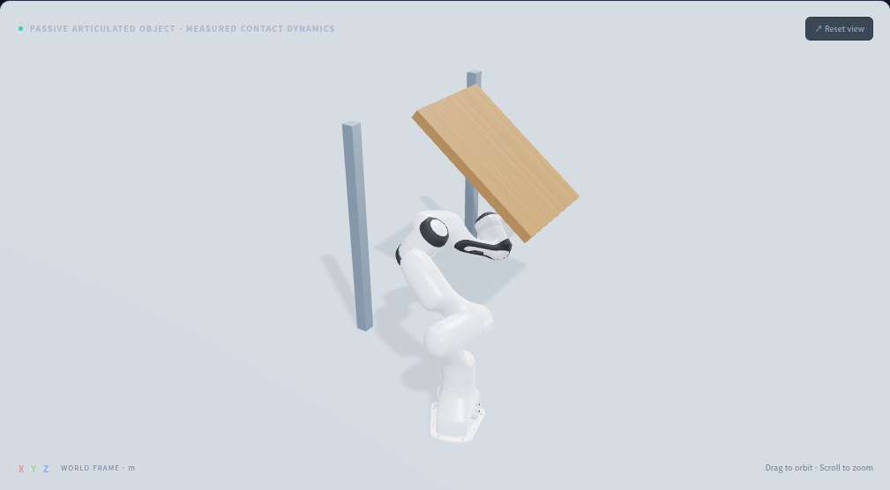
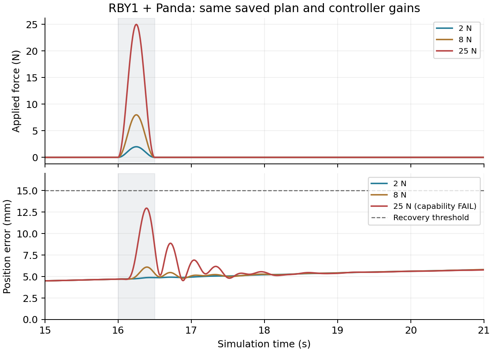

# Rendering, contact validation, articulated objects and datasets

실행 수치는 [기계 판독 결과](contact-validation-results.json)에 보관합니다. 세 articulated task는
본 논문의 단일 강체 패널 실험을 보완하는 확장입니다. Articulated contraction 학습이나
임의 다관절 물체에 대한 CITO를 구현·검증한 것으로 해석하지 않습니다.

## Rendering and physics

Studio 모드는 URDF visual/mesh 위에 PBR 재질·환경 조명·그림자·절차 생성 목재 texture를
적용합니다. 외부 HDR/texture 데이터셋을 배포하지 않습니다. Analysis/grid와 collision 표시를
계속 선택할 수 있습니다. 관절 좌표·물체 pose와 충돌 모델은 조명 변경에 영향을 받지 않습니다.
이 렌더링은 사실감을 개선한 실시간 뷰어이며 실사 영상이나 접촉 정확도의 근거는 아닙니다.

MuJoCo는 soft contact입니다. 이번 실행은 1 ms, implicitfast, elliptic cone, 80 iterations,
명시적 tool contact pair의 solref=[0.008,1], solimp=[0.95,0.99,0.001]을 사용합니다.
로그에 geom 설정뿐 아니라 pair friction/solref/solimp/dimension도 저장합니다.
Panda의 충돌 mesh는 convex hull로 계산하며 fixture는 authored primitive입니다.
예상하지 않은 penetration은 경로 샘플과 실행 중에 검사하지만 연속 형상 안전성 인증은 아닙니다.
접촉 물리의 실제 정확도를 주장하려면 실물의 질량/COM, 마찰, compliance, 파지 한계를
측정하고 궤적·접촉력·성공률을 실험과 비교해야 합니다. CRISP 교차 검증은 아직 추가하지 않았습니다.

기존 mobile 계획의 P 허용영역은 μ=0.8이고 엔진의 명시적 tool pair는 μ=0.9입니다.
따라서 후술한 25 N 결과는 **계획의 보수적인 허용영역 위반**이며 MuJoCo Coulomb cone
자체를 위반했다는 뜻이 아닙니다. G의 모멘트 한계도 실물에서 보정하지 않은 inner model입니다.
RBY1 바퀴 토크 40 Nm와 내부 servo 이득은 simulation 가정이며 caster는 낮은 마찰 skid 근사입니다.

## Three passive articulated tasks

각 task는 Panda 한 대와 고정 fixture에 연결된 수동 hinge/slider 한 개로 구성합니다.
문은 Z hinge를 0→60°, 접이식 상판은 Y hinge를 75→0°, 서랍은 rail을 0→220 mm
움직입니다. 전체 14초, 접촉/이동 시작/중간/목표/유지의 5 keyframe이며 이동은 2–11초입니다.
문·접이식 상판은 spherical point tool, 서랍은 native Panda gripper로 handle을 잡습니다.
초기 접촉·파지와 link-local contact 및 관절 경로는 제공됩니다. 세 task 자체에서는
small-scale source refinement나 network inference를 실행하지 않습니다.

물체 상태는 초기 한 번 설정한 뒤 적분하고, 물체 actuator·mocap·weld를 사용하지 않습니다.
고정 축/rail의 구속 반력은 수동 관절 모델이 담당합니다. 전체 강체 6D 평형 대신
관절의 일반화된 힘을 맞춥니다. 각 knot의 supplied q_o(t), 접촉 법선 n에 대해:

~~~math
M_o(q_o)\ddot q_o+h_o(q_o,\dot q_o)
 +d\dot q_o+kq_o+f_c\tanh(\dot q_o/10^{-3})
 =J_{p,o}(q_o)^\top n F,\quad 0\le F\le40\,\mathrm{N}.
~~~

Pinocchio의 RNEA가 M_o qdd+h_o를 계산합니다. 위 tanh는 계획에서 마찰을 부드럽게
근사하며 MuJoCo 실행에서는 native frictionloss를 사용합니다. 목표 물체 경로에서 팔 IK를
구하고 CasADi/IPOPT로 F 및 팔 토크 제약을 풉니다. 접촉 모드/관절 경로를 탐색하는 NLP는 아닙니다.
로봇에 작용하는 반력은 λ_f=−nF이며, 계획 토크는 τ=RNEA−J_pᵀλ_f입니다.
문에는 k=1.5 Nm/rad, d=0.4 Nm·s/rad, f_c=0.05 Nm; 상판은 k=0,d=0.3,f_c=0.02;
서랍은 k=0,d=8 N·s/m,f_c=2 N의 authored 가정을 사용합니다.
Point tool의 normal 방향 reference preload는 문 0.5 mm, 상판 0.2 mm이며 실제 관통량을
직접 강제하지 않습니다. Gripper는 실제 손가락 접촉으로 힘을 전달합니다.

Panda low-level simulation torque command는 다음과 같습니다. [혼합 좌표 관례](conventions.md)를
따르고 moment는 tool frame, force는 world frame입니다.

~~~math
\tau=\operatorname{clip}_{\bar\tau}\{\operatorname{RNEA}
(q,v,a_d+900(q_d-q)+60(v_d-v))-J_p^\top\lambda_f+J^\top[m_c;f_c]\},
~~~
~~~math
f_c=3000(p_d-p)+40(\dot p_d-\dot p),\qquad
m_c=40\log(R^\top R_d)^\vee+2(R^\top R_d\omega_d-\omega).
~~~

손가락에는 gain 3000/10의 position PD와 URDF effort clamp를 적용합니다. 실제 Franka/RB/RBY1
통신이나 제조사 내부 제어기를 실행한 결과는 아닙니다. RBY1 및 RB5 위치 명령과 내부 servo
수식은 [기존 제어 문서](panel-experiments-and-control.md)에 있습니다.

| Task | 목표 | 마지막 1초 최대 좌표 오차 | 이동 중 접촉율 | 최대 접촉력 | 판정 |
|---|---:|---:|---:|---:|---|
| hinged_door | 60.00 deg | 0.0572 deg | 96.36% | 11.03 N | PASS |
| folding_panel | 0.00 deg | 0.0047 deg | 100.00% | 13.82 N | PASS |
| drawer | 220.00 mm | 0.0787 mm | 100.00% | 2.38 N | PASS |

PASS는 hinge 최종 오차<2°, rail<12 mm, 3–11초 contact fraction>95%, actuator limit 및
비의도 penetration 검사를 모두 통과한 경우입니다. 문은 작은 접촉 손실이 있으므로 100% 유지로
표현하지 않습니다. 물체 actuator가 없다는 것만으로 성공을 판단하지 않았습니다:

- 같은 계획에서 robot–object contact만 끄면 문과 서랍은 초기 위치에 머뭅니다.
- 접이식 상판은 중력으로 1.50008 rad 한계까지 떨어져 목표에 실패합니다.
- 세 contact-disabled 실행 모두 접촉율 0%, task FAIL입니다.
- 문에서 dt를 1→0.5 ms로 줄여도 PASS입니다. 최종 오차 0.05715→0.05734°,
  contact fraction 96.36→96.48%입니다. 한 조건의 민감도 검사이며 수렴성 증명은 아닙니다.
- Hinge/slider의 M, gravity, contact-point Jacobian을 별도 MuJoCo native 계산과 비교합니다.
- 실행 전 샘플 경로와 실행 중 비의도 penetration은 이번 세 baseline에서 검출되지 않았습니다.

~~~bash
OPENBLAS_NUM_THREADS=1 python tools/run_articulated_suite.py --viewer web
# baseline 3개 + contact-disabled 3개 + 문 half-dt 1개
npm --prefix web run build
python web/server.py --port 8010
~~~

로컬 UI에서 세 preset과 12–60초 duration을 선택해 새 계획/실행을 계산합니다.
GitHub Pages는 무료 정적 재생으로, Python 계산 서버는 포함하지 않습니다.

## Prespecified external-force sweep

동일한 저장 mobile 계획과 동일한 제어 이득으로 패널 COM에 world-Y 외력을
16–16.5초 적용했습니다. 작용점 변환 후 mj_applyFT로 일반화된 힘에 투영합니다.
Point force와 자유 moment를 각각 기록하며 world/body frame을 구분합니다.

~~~math
f(t)=A\sin^2(\pi(t-16)/0.5)e_y,\quad16\le t\le16.5,
\qquad I=\int f(t)dt=0.25A e_y.
~~~

회복 판정은 18–20초 위치 오차<15 mm 및 16–20초 두 운반 접촉 유지입니다.
최종 task 판정은 기존 안착·릴리스·토크·접촉 허용영역 검사도 모두 포함합니다.

| Peak | Impulse | 16–20초 최대 위치 오차 | 18–20초 최대 위치 오차 | 회복 | 전체 task |
|---:|---:|---:|---:|---|---|
| 2 N | 0.5 Ns | 5.619 mm | 5.619 mm | PASS | PASS |
| 8 N | 2 Ns | 6.097 mm | 5.621 mm | PASS | PASS |
| 25 N | 6.25 Ns | 12.949 mm | 5.607 mm | PASS | FAIL |

25 N에서는 P의 μ=0.8 계획 cone을 최대 1.558 N 벗어납니다. 이를 회복 성공으로 숨기지 않고
FAIL로 유지했습니다. 각 강도당 결정론적 실행 한 번, 한 방향·한 작용점·한 시점입니다.
아직 통계적 성공률, 모든 외란 방향, 실험적 robust wrench margin 인증은 아닙니다.
논문에는 방향/작용점/시점 및 마찰·질량·초기 오차를 사전 지정한 sweep과 반복 실험을 추가해야 합니다.

~~~bash
OPENBLAS_NUM_THREADS=1 python tools/run_robustness_suite.py --plan outputs/mobile_panel
~~~

## Public datasets worth using

공개 접근 가능성과 무제한 재배포를 구별합니다. 이번 Pages에는 아래 데이터셋의 asset이나
대리 다운로드를 포함하지 않았습니다. 등록·승인이 필요한 약관은 대신 동의하지 않았습니다.

| Dataset / 공식 출처 | 우리 파이프라인에서 쓸 곳 | 부족한 항목 / 이용 조건 |
|---|---|---|
| [ContactPose](https://github.com/facebookresearch/ContactPose) | hand–object contact map과 기능적 grasp를 이용한 source contact prior | 가구 조립의 긴 시계열·우리 functional group ID 정답은 없음. 코드/기타 데이터 MIT, object model은 개별 라이선스, MANO 별도 조건 |
| [GRAB](https://grab.is.tue.mpg.de/) | 시간에 따른 손·전신·물체 pose와 접촉으로 temporal contact grouping 평가 | 주로 손으로 다루는 물체. 등록/라이선스 수락, 비상업 연구 조건과 body-model 조건 확인; 무단 재배포 금지 |
| [PartNet-Mobility](https://huggingface.co/datasets/sapien-sim/PartNetMobility) | 문·접이식 부품·서랍의 joint/URDF/mesh로 articulated target 다양화 | gated approval, 비상업 연구/교육 및 ShapeNet 조건. 관성·마찰은 실측 ground truth로 간주 불가 |
| [GAPartNet](https://github.com/PKU-EPIC/GAPartNet/tree/release) | actionable part와 part semantics를 target functional grouping에 활용 | 손의 실제 접촉력/그룹 정답과 다름. CC BY-NC 4.0, 데이터 access form/이용 조건 확인 |
| [FurnitureBench](https://github.com/clvrai/furniture-bench) | 가구 조립 geometry·demonstration·task baseline | dense hand contact/보정된 wrench ground truth 없음. 코드 라이선스만으로 data/model 재배포를 허용한다고 추정하지 말고 별도 확인 |

추천 조합은 ContactPose/GRAB의 source prior + PartNet-Mobility/GAPartNet의 articulated target +
FurnitureBench의 조립 task입니다. 소형 twin의 dense contact, keyframe, functional group ID와
동일 target의 하중·로봇 실행 기록은 직접 수집해야 본 논문의 scale/embodiment transfer를 비교할 수 있습니다.
