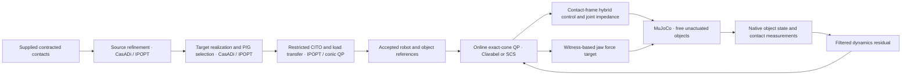
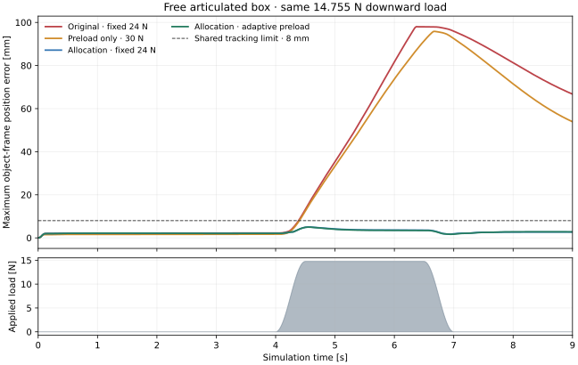

# Measured-state online wrench allocation — 24 November 2026

This is a controller extension for the accepted multi-arm plans. It does not
replace source refinement, contact-type selection or restricted CITO, and does
not upgrade the exact-manuscript or learned-inference gates. The experiments
below reuse previously accepted plans and perform fresh native MuJoCo runs.

## Implementation and common policy

`online_wrench.WrenchAllocator` caches the geometry-independent P/G cone
encoding and sparse quadratic cost. It shares the exact Coulomb cones,
eight-site gripper wrench maps and coupled per-jaw normal-force constraints
with the independent offline conic validator. There is no task-name dispatch
or disturbance schedule in this allocator.

`FullContactController` reads native object pose/velocity and all native object
contact wrenches. Contact signs, point origins and floating-base velocities
are converted to the public angular-first convention. Internal articulated and
inter-object contacts enter the generalized equations; non-robot contacts
also supply the measured environmental load. These are simulation sensor
assumptions, not a qualified hardware sensing stack. The controller never
reads the applied-force arrays, scheduled pulse or true disturbance value.

The new switches default to **off**, preserving the published baselines.
The public GitHub Pages viewer plays recorded native trajectories. It does
not run Python, optimization or robot control in the browser; the Python
commands execute those stages in the local/research environment.
The tested allocation update is 20 ms in simulated time, with an 80 ms
disturbance filter and object acceleration gains 100 s⁻² / 20 s⁻¹. The native
physics step and arm/jaw command step remain 1 ms. This is offline Python
simulation, not a hard real-time controller claim.

## Equations and force contract

Let lambda be object-on-robot reactions in the planned contact frames, A map
them to object generalized coordinates, and f_env be non-robot generalized
contact forces on the object. With native state q_o, v_o:

\[
M_o\dot v_o+b_o=-A\lambda+f_{env}+d,\qquad
\hat d=\operatorname{LPF}_{80\,ms}
 [M_o\hat{\dot v}_o+b_o-f_{contact,all}].
\]

Acceleration is estimated by finite differences of measured generalized
velocity. Reference velocity and acceleration are transported to the actual
body basis, including its rotational derivative terms. For the pose tangent
error e_o, the desired acceleration is

\[
a_c=a_r+100e_o+20(v_r-v_o).
\]

The QP variables y are physical contact forces, with lambda=B y. Every solve
uses current native mechanics and solves

\[
\min_y\;\|By-\lambda_{plan}\|_{W}^{2}+10^{-5}\|y\|^2
\]
\[
AB y=\hat d+f_{env}-b_o-M_o a_c,\quad
Ly\le b,\quad C_jy+c_j\in\mathcal Q_3,
\]

That full equality is enforced when active robot contacts span the object
generalized wrench space. After a **partial release**, it can be impossible to
independently command the released body's acceleration using contacts on the
other body. Execution therefore enforces UᵀAB y = Uᵀ rhs, where U spans the
active force-map image; it separately logs `(I-UUᵀ) rhs`, the controlled rank
and whether the full equation was enforced. This is an explicit underactuated
control projection, not an offline dynamics certificate. Native passive-body
tracking, contact support, release and insertion checks remain mandatory. The
strict allocator API retains full equalities by default; only the execution
adapter enables this projection. A full-rank case uses the original rows.

An intermediate assembly replay passed native task checks but produced 144
infeasible tracking requests after releasing the leg (active robots only
contacted the tabletop). Those logs are retained. The projection addresses
that control request; no source/target/CITO equality or native acceptance
threshold is removed.
\[
-\tau_{max}\le b_r-TBy\le\tau_{max}.
\]

Moment weights use 1/L² with the declared characteristic length L; force
weights are one. Released/unloaded interfaces have zero resultant reaction.
The native reduced-arm torque limits are QP constraints; the complete arm and
passive gripper dynamics are still independently checked in MuJoCo. A solver
status alone cannot pass: equality, inequality and circular cone residuals
must be below 2e-5. Rejected solves fall back to the original planned reaction
and remain recorded as rejected allocations, rather than certified outputs.
When every robot interface is released/unloaded, no tracking QP is requested:
the plan must request zero robot reaction and environmental dynamics carry
the object. Mode changes invalidate the held allocation immediately. Initial
panel replays exposed 279 infeasible requests after release with all three
interfaces inactive; those pilot logs are retained separately from active
contact allocation failures. The corrected gate skips that unactuated request.

Hardware per-jaw limit remains **40 N**. The tested allocation operating
budget is **24 N** (fraction 0.6). With adaptive jaw targets, the requested
normal preload is

\[
F^{jaw}_{cmd}=\operatorname{rateLimit}_{40\,N/s}
\left(\min\{32,\max\{F_{min},1.25\max_jF^{witness}_{n,j}\}\}\right).
\]

The minimum preloads retain the recorded scenario settings: panel 18 N,
box 24 N, assembly 28 N. The fixed-preload allocation ablation keeps box
24 N throughout. **Correction to the previous report:** the failed box probe
used 24 N, not 18 N. The native 40 N measurement limit is never increased.

`TargetPolicy.gripper_force_fraction` now lets source-independent target
realization and CITO use an explicit operating capability. Setting it to 0.6
uses 24 N in those optimizations while preserving the 40 N hardware model,
renderer, native mechanism and independent execution limits. A changed force
budget changes configuration/cache identity and requires a new plan. The
controller replay results here are not presented as fresh derated CITO solves.
`certify_controller_envelope.py` separately checks the accepted reference
geometry under the smaller budget and retains all unsuccessful conic solves.

At the arm level, P uses normal-force / tangential-motion selection and G uses
pose impedance with resultant reaction feedforward plus an independent jaw
force loop. Thus G is not described as six-axis force feedback. In mixed tool
coordinates the torque controller is

\[
\tau=ID(q,v,a_r)-J^T\lambda_d
+J_c^T[(I-S)(K_xe_x+D_xe_v)
+S(K_F e_F+K_I\int e_Fdt+D_Fe_v)]
+N^T[K_q(q_r-q)+D_q(v_r-v)],
\]

where e_F is measured minus desired object-on-robot reaction, S selects the
contact normal for P and is zero for G. Joint limits, torque clipping and
conditional integral anti-windup retain the existing implementation. The jaw
servo uses the existing passive-midpoint virtual force-admittance update and
native Robotiq driver position servos. Position-controlled arm adapters retain
the existing selected Cartesian admittance; this study executes Panda torque
arms only and does not qualify RB/UR hardware or mobile whole-body control.

## Validation scope and remaining work

### Measured results

All values below are native measurements with unchanged acceptance thresholds.

| Matched disturbance case | Original maximum error | Improved maximum error | Outcome |
|---|---:|---:|---|
| Box, 14.755 N downward | 98.033 mm | 5.041 mm, fixed 24 N preload | PASS |
| Box, same load, preload only increased to 30 N | 98.033 mm | 95.844 mm | FAIL |
| Box, same load, allocation and adaptive preload | 98.033 mm | 4.993 mm | PASS |
| Panel, original early 50%-margin load | 11.870 mm | 1.926 mm | PASS |
| Assembly, original early 50%-margin load | 9.640 mm | 0.883 mm | PASS |

The box fixed-preload and adaptive replays each accept 350/350 QPs. The fresh
baseline and preload-only controls reproduce the original tracking failure;
increased grip alone is insufficient. The improvement combines disturbance
estimation, object feedback and reaction allocation; the study does not isolate
their individual contributions. Early panel/assembly records precede the
release-scope correction and retain their late inactive/underactuated QP
rejections; their native physical completion and tracking checks pass.

| Final nominal complete sequence | Maximum position error | QPs accepted | Task result |
|---|---:|---:|---|
| Panel | 1.734 mm | 1151 / 1151 | Placed, all tools released; jig supports 19.620 N |
| Free articulated box | 1.456 mm | 901 / 901 | Hinge error 0.000832 rad |
| Two-body table assembly | 0.716 mm | 1420 / 1420 | Depth 25.001 mm, lateral error 0.298 mm; leg released |

The assembly QP enforces 12/12 dynamics directions in 1276 updates and the
6/12 actuated directions in 144 updates after leg release. This scope is
recorded per update. All native task, retention, jaw, actuator and sampled
interface checks pass, including the passive leg. The three nominal sequences
use the corrected release handling; box/panel use the original full-rank QP
equations while robot contacts are holding.

At the accepted mid-task geometry, 24 N/jaw static margin lower bounds are
14.755409 (box), 7.046958 (panel) and 4.183308 (assembly), in the declared
dimensionless task coordinates. Assembly's initial maximum solve was not
accepted; the retained fixed-rho solve certifies the reported lower bound.
Both previously tested signed physical loads have separate feasible 24 N/jaw
static witnesses in all three tasks. The assembly load is not claimed to lie
inside the smaller all-direction operating box merely because that particular
direction is feasible. None of these geometry checks is a new CITO solve.

There are **19 completed fresh physical trials**, including repeated controls
and intermediate controller versions: 15 pass and four retained negative
controls fail tracking. One superseded, unfinished assembly diagnostic is
recorded separately and excluded from that count. The complete ledger,
allocation logs, compact trace metadata, scene files, code snapshots and SHA-256
identities are in [the evidence archive](validation/controller_2026-11-24/summary.json).
The exact full NPZ traces remain in the local outputs; their hashes are retained.

Validation includes the 250-test regression suite, 19 targeted final checks
(overlapping the suite), exact-cone Clarabel/SCS unit checks, and an outside-
checkout wheel smoke test (`0.2.0a3`, QP residual 1.78e-15). QP median times are
about 3–5 ms. Some p99 times exceeded the configured 20 ms simulated update
period under concurrent CPU load; real-time deadline compliance is not claimed.
The viewer regression has 47 passing browser tests plus three focused final
checks. Three previews using the real pinned Panda/Robotiq meshes pass with no
browser exceptions. A controller-only result-panel assumption found by that
render check was corrected; its initial diagnostic is retained with the logs.

The load in the failed box case is unchanged: 14.7545885 N downward on the
free articulated object's base, 80% of the original optimized static box
margin. Native scene, plan, thresholds (8 mm, 0.06 rad, 99% contact retention),
force limits and physical pulse are matched. Full-task regression tests also
retain the original endpoint and handoff/release schedule. Each condition is
one trial, not a statistical success-rate estimate.

Numerical results and immutable file hashes are collected in the accompanying
controller-study evidence. The original failures remain available. Static
feasibility, measured tracking, allocation acceptance and task completion are
separate fields. A static reference certificate is not a closed-loop stability
proof. Exact manuscript post-step Panda transcription, full learned network
inference and native CRISP cross-validation remain outside this extension.
