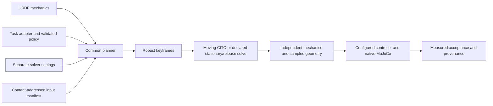

# Framework alpha: configuration, solvers and deployment

Version `0.2.0a1` packages the common planning pipeline, explicit task policies,
backend selection and independent acceptance gates. The alpha label matters:
it is a distributable research framework, with the qualified scopes below,
not a hardware-ready product or a certificate of arbitrary contact stability.

Original code is Apache-2.0 following the owner's license choice. Bundled models
retain their upstream notices. [Third-party conditions](../THIRD_PARTY_NOTICES.md)
also apply to optional solvers and simulators.
The existing KUKA URDF remains GPL-3.0-or-later. Wheel metadata therefore lists
the aggregate code/model licenses; it does not label every bundled file Apache-2.0.

## Install and run outside the repository

```bash
python -m pip install build
python -m build
pip install 'dist/scale_aware_contact_transfer-0.2.0a1-py3-none-any.whl[full,alternative-solvers]'

contact-transfer doctor
contact-transfer assets
contact-transfer config --task panel
contact-transfer run --task panel --solver ipopt --conic-solver clarabel \
  --output outputs/panel-trial
```

These commands build and install from a checkout; this change does not publish
a PyPI release. `python -m build` produces the wheel and sdist.
The CLI, task profiles, URDFs and model licenses are included in the wheel.
Large browser recordings are excluded from the source distribution; use the
repository/viewer for the archived experiments.

Asset preparation is explicit. Imports do not download anything. The downloader
checks pinned SHA-256 values and preserves upstream license files. Existing
corrupted/modified assets are rejected; `assets --refresh` explicitly restores
the pinned files. Runtime `.cache/` and `outputs/` are relative to the working
directory, so an installed package does not write into site-packages.

## Separation of responsibilities

| Layer | Public entry / source | Role |
|---|---|---|
| Mechanical models | `Robot`, packaged URDFs | Dimensions, mass, inertia, axes, limits, locked joints, gravity |
| Task adapters | `FullTask.load` | Object topology, surfaces, feature/frame identity, layout, keyframes and fixtures |
| Task policies | `TaskConfiguration`, `scenarios/framework_profiles.json` | Source/target trust regions, phases, disturbance image, integration choice and execution parameters |
| Numerical settings | `SolverSettings`, `ConicSettings` | Backend, tolerance, iteration budget and backend options |
| Common planning | `FullPlanner`, `refinement`, `paper_keyframe`, `sequence`, `trajectory`, `full_static` | Refinement, realization, candidate search and moving/stationary interval optimization |
| Acceptance | `full_validation`, `full_assessment` | Native mechanics, conic witnesses, sampled geometry, measured task/contact limits |
| Provenance | `provenance`, `full_recording` | Input manifest, versioned stage identity, atomic numeric archives |

Task-specific geometry construction remains in adapters: a box hinge and two
independent assembly bodies are different mechanical systems. This is not a
claim that moving every conditional to JSON eliminates all experimental assumptions.
The panel IK branch/layout is also explicitly declared in `full_layouts.json`.



## Configuration overrides

`contact-transfer config --task box` prints all resolved defaults. Pass a JSON
override with `--configuration path.json`; unknown top-level fields, invalid
dimensions, nonfinite scales and unsupported modes are rejected. Both resolved
policies and a full planning input manifest are written with a trial.

```json
{
  "source": {"failure_policy": "error"},
  "target": {"position_radius_m": 0.015, "posture_weight": 0.01},
  "execution": {
    "control_mode": "impedance_feedforward",
    "physics_dt_s": 0.001,
    "joint_k": 40.0,
    "joint_d": 8.0
  }
}
```

Mechanical limits and disturbance E/D are problem inputs, not tuning knobs to
make a failed result pass. Preserve them and all acceptance thresholds in
solver/ablation comparisons. The built-in box and assembly profiles explicitly
allow the manuscript's geometric-prior source fallback. To require a successful
source certificate, use `--source-failure-policy error`.

For a JSON source fixture, its mass, friction, force limit and surface charts
are authoritative physical data. The source policy supplies the refinement
trust radii, geometry weight and failure policy. The `mu`, `normal_max_N` and
`patch_half_size_m` source policy entries apply to the scaled-URDF source adapter
used by the other tasks. File-source outputs report the effective parameters;
the panel default retains its existing 2 mm source trust radius.

Source diagnostics distinguish proven free-body wrench-span insufficiency from
local NLP infeasibility/numerical failure. A frozen-anchor SOCP diagnostic checks
only those anchors and is never promoted to a global surface-feasibility proof.
For the assembly's P-only source, two tabletop points have maximum rank 5 and
one leg point rank 3, while each requested load image has rank 6. Skipping that
impossible NLP is a structural test, not a solver success or a new source certificate.

## Cache contract

The old cache omitted source-file contents. Schema 2 binds task data, source and
fixture references, complete robot/object model identities, policies, numerical
settings, installed numerical-library versions and package Python source.
This conservative source-code dependency rule can invalidate more caches than
strictly necessary; it avoids untracked indirect formulation changes.

Keyframe identities include the actual previous posture/material points;
interval identities include the actual endpoints. Changing inputs during a
live planner is rejected and requires reloading the task. Execution and native
acceptance gates still run on cache hits. NPZ replacement is atomic and does
not enable pickle loading. Planning archive reuse also requires an identical
schema-2 manifest, and verifies actual endpoints and current time bounds.
Unknown or legacy manifests are cache misses. An explicit recorded-plan replay
independently revalidates old data and reports that no new target/CITO solver
was executed; it is not a planning cache hit or a fresh solve measurement.

Source solutions are reused across discrete candidates only for the same full
source identity, with defensive copies and cache-hit provenance. Symbolic robot
graphs use a bounded process cache, with separate mutable metadata/limits and
no shared mutable Pinocchio Data. A changed URDF requires reconstructing `Robot`.

## Solver choices and numerical scope

| Backend | Purpose | Selection / status |
|---|---|---|
| IPOPT via CasADi | Source/target NLP, CITO and released-arm NLP | Default |
| SNOPT via CasADi | Same NLP interface | Optional plugin/runtime/license; unavailable in the current validation environment |
| Clarabel | Frozen-geometry SOCP and conic QP | Default; exact circular friction cones |
| SCS | Same canonical conic matrices | Optional extra; the same independent unscaled residual gate applies |
| FATROP via CasADi | Experimental qualification | Small NLP works; stationary CITO aborted natively in qualification. Excluded from normal CLI choices and requires explicit experimental opt-in in the low-level API |

No unavailable or failed backend silently falls back to another solver. In
particular, an unavailable solver cannot become a geometric source fallback.
The common scenario IPOPT profile has a per-NLP CPU budget; the SNOPT path does
not currently enforce that same CPU option. Use isolated process wall-time
limits for fair cross-library benchmarks. Primal acceptance remains separate
from solver objective/KKT stopping criteria.

`tools/benchmark_cito_solvers.py` runs every trial in a new process and retains
native exit codes, errors and timeouts. The benchmark is a stationary 8-node
contact problem; it is not a benchmark of full Panda assembly. The sparse conic
rewrite retains the formulation while replacing per-vertex LIL conversions with
block/Kronecker assembly and reporting assembly/solve/validation timings.

Static target realization also eliminates actuator torques algebraically when
the actuation map is a coordinate selector. For static generalized bias b and
contact load J^T lambda, it reconstructs tau=B^T(b-J^T lambda), keeps every torque
bound, and constrains the remaining unactuated balance rows. This is the same
feasible set and objective with fewer variables/equalities. Non-selector maps
retain the explicit formulation. Both paths are checked against independent
Pinocchio dynamics, including a binding torque limit.

## Control, geometry and CRISP

Built-in qualified full-task recordings use planned-reaction feedforward plus
Cartesian/joint impedance, `Sf=0`, and a separate native Robotiq jaw-force loop.
Hybrid force feedback can be selected explicitly. Force axes include velocity
damping, with no competing position stiffness, and actuator saturation freezes
the force integrator. Existence of the option does not certify arbitrary
full-task or hardware performance. RB/UR position admittance and its
constant-diagonal virtual-system PMI primitive remain separate from MuJoCo's
multibody integrator.

The shared `scenarios/panda_hybrid_control.json` override selects hybrid force
feedback with the same 160 N·s/m normal damping qualified on panel, box and
assembly. See the validation report for the passing trials and rejected
lower-damping comparison. Base profiles preserve impedance/feedforward.

Independent/contact-coordinate midpoint are declared variants of the manuscript
transcription. Dense robot references subdivide each optimized time cell rather
than merging two floating-point clocks. They retain every optimized time node
and its velocity exactly; joint configurations remain subject to the reported
bounded IK projection. Mesh spacing and maximum joint acceleration are reported. Geometry
is sampled, and `continuous_certificate` remains false. Box/articulated and
multi-object assembly are explicit extensions of the single-rigid-body paper.

CRISP is present in `crisp_simulation.py` and `backends/crisp`, with CANAL and
SubADMM selection in the first rigid-panel runner:

```bash
python tools/run_paper_panel.py --engine crisp --crisp-solver canal \
  --crisp-binary .cache/crisp-adapter-build/crisp_scene_bridge
```

The SDK is external and is not installed in the current environment. The bridge
is limited to fixed-base torque-controlled Panda arms and one rigid panel,
excluding the native closed-loop Robotiq mechanism. It is not the engine used
by the three full-task examples and is not qualified for their box/assembly
models or mobile-base/hardware execution. `doctor` reports these scopes and
binary availability separately from the existence of bridge code.

## Reproducibility and release checks

Run the repository pytest suite with native assets present, the analytical
refinement/conic examples, isolated solver qualification, fresh scenario runs,
and an installed-wheel smoke check outside the checkout. CI includes a wheel
job and optional SCS tests. Record cold solves and explicit archive reuse
separately; preserve failed candidates and failed physical trials.

Deployment preparation does not publish new performance claims for historical
web recordings. The pre-change [solver review](framework-solver-review-2026-11-23.md)
and its measurements remain historical evidence. Release measurements and fresh
execution results must identify the tested source revision and configuration.
See [the alpha validation report](framework-upgrade-validation-2026-11-23.md)
for measurements, failed controls, source-certificate limits and reproduction
commands.
