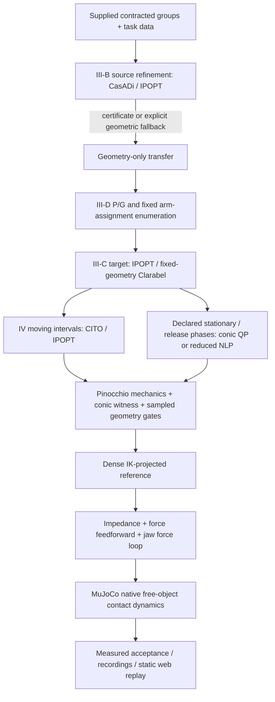

# Contact-transfer framework / solver 검토

검토일: 2026-11-23. 대상은 `feat/conic-contact-validation`의
`4446273fa12645584a465969992db1a0e457da67`이다.
기본 `main`의 `d7308f3`와 구분해야 한다. 이 문서는 해당 revision의 검토이며,
아래 결함이 수정되었다는 의미가 아니다. 이 검토 단계에서는 실험의 역학·제어·목적함수를 변경하지 않았다.
이후의 수정, 새로운 물리 실행 및 남은 한계는
[framework alpha 검증 보고](framework-upgrade-validation-2026-11-23.md)에 기록했다.

원고 기준은 사용자가 지정한 11쪽 `Contact_contraction_MS_TRO (2).pdf`이다.
이번 새 작업환경에는 원본 PDF가 없어, 해당 파일의 SHA-256
`03deabc2ff306db8582cda6ab24becab4e6681397ab4a5a4367c55ca7d9fe3ba`를 명시한
[기존 수식 대조 기록](manuscript-equation-audit.md)을 기준으로 코드를 검토했다.
원문을 이번에 다시 열어 독립 대조한 검토는 아니다. 과거 v12의 SNOPT 설명은
최신 첨부 원고의 CasADi/IPOPT 절차와 구분한다.

## 판단

**공통 수식·역학·검산 계층은 구현되어 있다. 그러나 모든 시나리오가 추가 가정 없이
같은 원고 문제를 푼다고 말할 수는 없다.** 현재는 공통 최적화 코어에 과제별 제한,
접촉 시간표, 적분 선택, 실행 설정을 결합한 제한된 실험 구현이다.

세 새 시나리오의 움직이는 물체 구간은 공통 CITO를 호출한다. 정지·하중 이양·릴리스는
별도 축약 문제를 사용한다. 이는 선언된 정지 조건하에서 타당한 계산 단축과,
원래 탐색 공간에 조건을 추가하는 실험 설계를 구분해서 설명해야 한다.
특히 박스·조립의 source refinement certificate는 저장된 본 실험에서 확보되지 않았다.

아래에서는 재현된 결함, 실험의 제한, 성능 개선 제안을 구분한다. 새로운 접촉 물리
수식 오류를 재현한 것은 아니다. 실행 성공만으로 원고 전 단계의 검증이 완료되었다고
판단하지도 않는다.

## 우선 검토 결과

### 1. P1 — source 입력 변경을 놓치는 캐시 식별자: 재현된 결함

근거: [`full_recording.fingerprint`](https://github.com/overjs94/scale-aware-contact-transfer/blob/4446273fa12645584a465969992db1a0e457da67/src/contact_transfer/full_recording.py#L24),
[`FullPlanner.keyframe`](https://github.com/overjs94/scale-aware-contact-transfer/blob/4446273fa12645584a465969992db1a0e457da67/src/contact_transfer/full_pipeline.py#L61),
[`FullProblem.source`](https://github.com/overjs94/scale-aware-contact-transfer/blob/4446273fa12645584a465969992db1a0e457da67/src/contact_transfer/full_scenario.py#L284).

`fingerprint`는 feature, keyframe, URDF, solver 설정과 일부 모듈을 해시하지만,
패널의 원본 source JSON 전체를 해시하지 않는다. 접촉점이 같아도 source 질량,
마찰, 힘 한계, refinement 반경은 달라질 수 있다. 일반 캐시가 맞으면 source 계산을
건너뛰며, 뒤의 native/Clarabel 검사는 주로 target의 물리적 가능성을 확인한다.
따라서 source 문제 자체가 달라졌다는 사실을 복구하지 못한다.

재현은 임시 복사본에서만 수행했다.

| 변경 | 변경 전 | 변경 후 |
|---|---:|---:|
| source `normal_max_N` | 2 N | 0.01 N |
| 새로 계산한 source | certificate 있음, rho = 0.53206744 | `PrimalInfeasible` |
| stage fingerprint | `dd733ba3…915e` | **동일** |

실제 과거 기록이 이 결함으로 오염되었다는 증거는 아니다. 다만 변경된 source가
이전 최적화 결과로 대체될 수 있는 경로를 확인했다. 명시적 `--keyframe-archive`는
fresh source 계산을 수행하므로 일반 캐시 경로와 구분해야 한다.

수정 우선순위: 원본 source/task 데이터, fixture/수동 관절 물성, 실제 수식 의존 모듈을
포함한 입력 manifest를 만들고 그것을 해시한다. 현재 목록에는 `refinement.py`,
`pipeline.py`, `contacts.py`, `optimization.py`, `symbolic.py`도 직접 포함되지 않는다.
기존 캐시는 새 schema에서 재사용하지 않고, source 힘 한계·질량·마찰·반경을 각각
바꿨을 때 반드시 cache miss가 되는 검사를 추가해야 한다.

### 2. P1 — 박스·조립 결과는 source refinement 효과를 검증하지 못함

근거: [`pipeline.source_prior`](https://github.com/overjs94/scale-aware-contact-transfer/blob/4446273fa12645584a465969992db1a0e457da67/src/contact_transfer/pipeline.py#L20),
[`FullProblem.source`](https://github.com/overjs94/scale-aware-contact-transfer/blob/4446273fa12645584a465969992db1a0e457da67/src/contact_transfer/full_scenario.py#L284),
[저장된 세 과제 결과](full-scenario-results.json),
[기존 비교 감사](contact-geometry-and-comparison-audit.md).

박스와 조립은 source 문제를 시도하지만 실패하면 기하 prior로 돌아가고
`source_certificate=False`를 기록한다. 이 fallback 자체는 원고의 허용된 분기이며
target의 물리 실패를 숨긴다는 뜻은 아니다. 그러나 source refinement를 켠 조건과 끈
조건이 같은 prior를 쓰면, 그 비교는 III-B의 효과를 측정하지 못한다.

논문에서는 다음을 분리해야 한다.

- source 단계가 통과한 패널: source refinement 효과를 평가할 수 있는 기준 과제.
- 박스·다물체 조립: source 실패/fallback을 포함한 확장 과제. 성공한 source refinement
  실험으로 집계하지 않는다.
- 학습 출력: 현재 입력은 합성 contracted groups이며 trained network inference는 실행되지 않는다.

수정 방향은 이 실패를 물리 모델 부정합, 실제 불가능성, 수치 실패로 먼저 분류하는 것이다.
source의 P-only 모델이 요구 wrench image를 만들 수 없는 조건을 단순히 solver 교체로
해결할 수 있다고 가정하면 안 된다. 이 검토에서는 새 source 설계를 만들지 않았다.

### 3. P2 — 시나리오별 탐색 제한과 접촉 시간표가 공통 코어에 섞여 있음

근거: [`FullTask.load`](https://github.com/overjs94/scale-aware-contact-transfer/blob/4446273fa12645584a465969992db1a0e457da67/src/contact_transfer/full_scenario.py#L131),
[`FullProblem.keyframe`](https://github.com/overjs94/scale-aware-contact-transfer/blob/4446273fa12645584a465969992db1a0e457da67/src/contact_transfer/full_scenario.py#L309),
[`interval_contacts`](https://github.com/overjs94/scale-aware-contact-transfer/blob/4446273fa12645584a465969992db1a0e457da67/src/contact_transfer/full_trajectory.py#L120),
[`FullEpisode`](https://github.com/overjs94/scale-aware-contact-transfer/blob/4446273fa12645584a465969992db1a0e457da67/src/contact_transfer/full_execution.py#L17).

| 현재 규칙 | 분류 / 영향 |
|---|---|
| 모든 G 접촉 위치는 feature surface에 고정, P 위치는 첫 keyframe 이후 이전 material point로 고정 | no-regrasp 실험의 추가 제약. 매 keyframe의 자유로운 target geometry refinement와 동일하지 않음 |
| 모든 해당 planar patch의 법선 고정 | 허용된 제한 모델이지만 법선 최적화 효과를 평가하지 않음 |
| 패널의 sequential IK branch 주변 ±0.3 rad 제한 | 초기값 선택에 그치지 않는 추가 joint bound. 다른 IK branch를 탐색하지 않음 |
| 패널 `above_jig → seat`에서 환경 반력을 마지막 node에만 허용 | 지그 접촉 시작 시각을 부분적으로 수동 지정. 전체 접촉 모드 발견을 CITO가 수행했다고 할 수 없음 |
| `open_gripper` / `open_leg_gripper` +0.8 s dwell, freeze posture/holding posture | 현실적인 실행 설계지만 자동 획득된 동작 시간표가 아님 |
| `leg_gripper` 이름에 따른 unload/release 분기 | object/feature 역할을 명시하는 task schema로 이동할 필요 |
| jaw force fraction: panel 0.45, box 0.6, assembly 0.7 | 계획된 finger witness에서 공통 규칙으로 도출한 값이 아닌 과제별 제어 설정 |

반대로 URDF, keyframe 목표, 마찰·힘 한계, E/D, 허용 공구, fixture는 과제마다 달라도
되는 **문제 데이터**다. 이것까지 모두 휴리스틱으로 간주할 필요는 없다. 다만 데이터와
탐색 제약을 명시적으로 선언하고, solver 내부의 task ID 문자열 분기를 줄여야 한다.

### 4. P2 — 적분 및 reference 수정이 동일한 최적화 문제의 solver 옵션으로 취급되면 안 됨

근거: [`solve_interval`](https://github.com/overjs94/scale-aware-contact-transfer/blob/4446273fa12645584a465969992db1a0e457da67/src/contact_transfer/full_trajectory.py#L213),
[`validate_interval`](https://github.com/overjs94/scale-aware-contact-transfer/blob/4446273fa12645584a465969992db1a0e457da67/src/contact_transfer/full_validation.py#L130),
[`FullEpisode`](https://github.com/overjs94/scale-aware-contact-transfer/blob/4446273fa12645584a465969992db1a0e457da67/src/contact_transfer/full_execution.py#L32).

움직이는 패널·박스는 기본 `contact_coordinate_midpoint`, 조립은
`independent_midpoint`를 사용한다. 원고 대조 기록의 poststep Euler와도 다르다.
contact-coordinate 방식은 일부 robot joint를 closure의 종속 좌표로 취급하므로,
모든 joint에 독립 midpoint 식을 적용하는 문제와 동일하지 않다. 검산기도 그 좌표의
재구성 오차와 chart conditioning을 별도로 기록한다. 이를 단순한 solver 수렴 개선으로
설명하면 formulation 차이가 사라진다.

실행 reference는 nodal Hermite 궤적을 20 ms 간격의 native IK로 재투영하고
최대 0.02 rad 수정과 velocity/geometry 검사를 적용한다. 물체는 MuJoCo에서 free body로
움직이지만, 로봇이 추종하는 조밀 궤적은 원래 NLP node의 단순 보간과 다르다.
재투영 후 조밀한 동역학 residual/필요 토크를 검사하거나, 수정량이 grid refinement에
따라 감소함을 보이는 것이 좋다. 현 gate만으로 수정된 reference 전체가 원 NLP의
동역학 최적해라고 주장할 수 없다.

통일 방향: task 이름 대신 contact topology에 따라 적분 방식을 명시하고,
같은 물리 조건의 16/32/64 node 비교와 native dt 수렴 검사를 기록한다. PMI와도 구분한다.

### 5. P2 — 유형/팔 배정 최적화는 실제 존재하지만 제한된 로컬 후보 탐색임

근거: [`FullPlanner.preflight`](https://github.com/overjs94/scale-aware-contact-transfer/blob/4446273fa12645584a465969992db1a0e457da67/src/contact_transfer/full_pipeline.py#L40),
[`FullPlanner.search`](https://github.com/overjs94/scale-aware-contact-transfer/blob/4446273fa12645584a465969992db1a0e457da67/src/contact_transfer/full_pipeline.py#L168),
[`choose_sequence`](https://github.com/overjs94/scale-aware-contact-transfer/blob/4446273fa12645584a465969992db1a0e457da67/src/contact_transfer/sequence.py#L25).

P/G 후보와 injective 팔 배정을 열거해 keyframe 및 interval 비용으로 비교한다.
다만 원래 P인 feature는 P로 제한하고, 각 후보의 공구·팔 배정은 시퀀스 내내 고정한다.
온라인 공구 교환이나 keyframe별 재배정은 구현하지 않는다.

preflight는 nominal feature 위치의 로컬 IK 실패로 후보를 제외한다. 접촉점 이동이나
다른 seed/IK branch로 가능한 후보까지 탈락할 수 있다. `choose_sequence`의 비용 하한도
이미 로컬하게 얻은 endpoint에 조건부인 하한이며 전체 IK 공간에 대한 전역 bound가 아니다.
현재 코드와 기록은 이를 명시하므로, 논문 표에서도 `local solve failed`,
`structural rank infeasible`, `conditional cost pruned`를 구분해야 한다.

원래 7조건 비교에서 선택된 조합은 supplied fixed-type baseline과 같았다. 이후
[별도 강제 유형 비교](algorithm-comparisons-and-scope.md)가 추가되었다. 패널 PPP는
GPP보다 목적값이 33.5436 증가하고 native 실행에 실패했으며, 박스 PPG는 GPG보다
78.3572 증가하고 native 실행에 실패했다. 조립 GPP는 free leg의 wrench rank 부족으로
탈락했다. 이 후속 결과는 현재 제한된 실험에서 유형 선택의 유효성을 뒷받침한다.
전체 열거가 모든 IK 해를 포함하거나 대안이 전역적으로 불가능하다는 증명은 아니다.
원래 fixed-type ablation과 후속 강제 후보 재최적화 결과를 구분해서 제시해야 한다.

### 6. P2 — 의도한 충돌의 판정도 공통 contact 정의에서 도출할 필요

근거: [`Geometry.intended`](https://github.com/overjs94/scale-aware-contact-transfer/blob/4446273fa12645584a465969992db1a0e457da67/src/contact_transfer/full_validation.py#L178).
현재 geom 이름의 prefix와 task ID로 의도된 접촉을 판별한다. 조립에서는 물체 geom끼리의
모든 쌍이 intended로 분류된다. 이것이 모든 관통을 허용한다는 뜻은 아니다. intended여도
기본 비관통 검사는 남고, pad에 한해 작은 compliance allowance를 둔다. 그러나 계획된
삽입 interface 밖의 물체 간 근접 접촉도 clearance 대상으로 구분하지 못할 수 있다.
task schema의 허용 geom pair·phase에서 이 규칙을 생성하면 최적화의 접촉 후보와 native
assessment가 같은 의미를 갖게 된다. 현재 geometry gate는 샘플 검사이며 연속 충돌 증명이 아니다.

## 현재 solver / library 지도

CasADi는 미분 가능한 문제와 함수를 만드는 계층이고, 실제 NLP solver는 IPOPT이다.
Pinocchio도 최적화 solver가 아니라 독립 역학·기구학 계산기다.

| 단계 | 구현 | 실제 계산 / solver |
|---|---|---|
| III-A contracted groups 입력 | `source_transfer.py`, task JSON | supplied/synthetic 데이터. trained inference 없음 |
| III-B source surface refinement | `refinement.py`, `pipeline.py` | CasADi `Opti` + **IPOPT**. 고정 E/D와 vertex별 반력, 공통 P 모델 |
| III-C target geometry/posture/rho | `paper_keyframe.py`, `realization.py` | CasADi `Opti` + **IPOPT**, joint/closure/finger/torque 제약 |
| 고정 geometry wrench margin / 독립 witness | `conic.py`, `generalized_conic.py` | **Clarabel SOCP**. fixed-rho witness와 torque 비용을 넣으면 conic QP |
| 고정 material-point target 축약 | `full_static.fixed_geometry_keyframe` | **IPOPT** posture IK + torque-free **Clarabel** margin 상한 + 동일 rho의 torque feasibility. 실패 시 coupled target NLP |
| III-D 공구·팔 배정 | `sequence.py`, `full_pipeline.py` | Python `itertools` 열거·조건부 가지치기. MILP/MINLP solver 사용 아님 |
| IV moving-object CITO | `trajectory.py`, `full_trajectory.py` | CasADi + **IPOPT**. states/torques/impulses/dt, 접촉·마찰 continuation 및 최종 residual gate |
| 정지 / load transfer | `full_static.stationary_interval` | 선언된 정지 상태를 소거한 **Clarabel conic QP** |
| 지원 물체 고정, released arm 이동 | `full_static.released_arm_interval` | holding/object 좌표를 고정한 **IPOPT NLP** |
| 초기화·endpoint polish·dense projection IK | `contracted.py`, `full_scenario.py` | **SciPy `least_squares`**, bounded local IK; 선형 velocity projection은 NumPy/SciPy |
| 별도 constrained geometric IK API | `ik.py` | CasADi `Opti` + **IPOPT**. 위 native least-squares IK와 구분 |
| 고정 경로·legacy mobile/free-object | `fixed_path.py`, `mobile_panel.py`, `free_articulated.py`, `table_assembly.py` 등 | IK로 path를 정한 뒤 **IPOPT**로 반력/토크 최적화. full CITO와 별도 |
| 공통 로봇 역학 | `symbolic.py`, `robot.py`, `system.py` | URDF → custom CasADi symbolic RNEA, **Pinocchio** native RNEA/CRBA/Jacobian 검산 |
| low-level torque / position 제어 | `hybrid_control.py`, `paper_execution.py`, `robotiq.py` | NumPy/Pinocchio 모델 기반 제어 + gripper force loop. 매 제어 step에서 IPOPT를 풀지 않음 |
| native contact dynamics | `full_scene.py`, `contact_simulation.py` | **MuJoCo** contact solver; implicitfast, elliptic cone, 기본 dt=1 ms |
| 선택적 cross-check | `crisp_simulation.py`, C++ bridge | **CRISP CANAL / SubADMM**. 현 bridge는 fixed-base Panda와 rigid panel로 제한; native closed-loop Robotiq·세 새 과제 전체의 대체 backend가 아님 |
| 정적 웹 결과 | `web/` | Three.js/URDF viewer의 녹화 재생. Python server가 없으면 새 최적화·시뮬레이션 실행 안 됨 |

`optimization.SolverSettings`는 `snopt`도 선택할 수 있지만 이번 환경에는 plugin이 없다.
현재 full scenario 기본값은 IPOPT이며 sparse linear solver를 코드에서 별도 지정하지 않는다.
SNOPT 실행 시간이나 우월성은 확인하지 못했다.

고정 geometry의 conic 분리는 목적함수/제약이 같을 때 타당하다. 반면 posture IK는 비선형
로컬 해이므로 분리 target 전체의 전역 최적성을 얻었다고 주장하면 안 된다.
현재 certificate도 `posture_global_optimality_claimed=False`를 기록한다.

## 과제별 동일성 및 저장된 증거

아래는 체크인된 recording을 읽어 확인한 결과다. 이번에 native 세 과제를 새로 돌린 결과는 아니다.

| 과제 | Source certificate가 기록된 keyframe | 후보 수 | 선택 | 움직이는 물체 구간 | 정지/릴리스 | 저장된 native |
|---|---:|---:|---|---|---|---|
| 패널 | 9/9, 동일 pose의 재사용 포함 | 12 | G/P/P | contact-coordinate midpoint CITO | conic QP / released-arm NLP | PASS |
| free box/lid | 0/8, geometric fallback | 24 | G/P/G | contact-coordinate midpoint CITO | conic QP | PASS |
| tabletop + leg | 0/10, geometric fallback | 24 | G/P/G | independent midpoint CITO | conic QP / released-arm NLP | PASS |

모든 selection 기록은 `manuscript_literal_equations_passed=False`,
`full_paper_pipeline_executed=False`를 명시한다. `all_moving_object_intervals_cito_optimized=True`
와 전체 원고 pipeline 검증은 다른 주장이다. 세 recording의 planning time에는 cache hit가
섞여 있으므로 그 값을 cold solver benchmark로 비교하면 안 된다.

박스의 generalized load는 base의 세 힘 + hinge torque인 4차원 disturbance image다.
조립의 `E=[0.8 I6; 0.2 I6]`는 두 body에 연동된 6차원 disturbance를 주며,
12 generalized load를 독립적으로 모두 변화시키는 robustness가 아니다.
이 선택은 확장의 명시적 task 정의로 제시해야 한다.

RB5-850E / UR의 position-command 경로, RBY1 mobile-base 과제, G1 preview는
이 새 `FullPlanner`의 세 Panda 과제와 별도 경로다. URDF preset과 제어 class의 존재만으로
해당 embodiment에서 III-B–IV 전체가 검증되었다고 판단할 수 없다.

## 제어 및 robustness의 해석

세 full-task 실행은 `FullEpisode`가 `impedance_feedforward`를 선택한다.
`paper_execution.py`에서 이 mode의 force projector는 `S_f=0`, `S_m=I`가 된다.
angular-first / object-on-robot 반력 convention 아래 torque-arm의 실제 구성은

```math
\tau=\operatorname{clip}\left[
\operatorname{RNEA}(q,v,a_d)-J^T\lambda_d
+J_c^T(K_xe+D_x\dot e)
+N^T\{K_q(q_d-q)+D_q(v_d-v)\}\right].
```

즉 계획 반력 feedforward + Cartesian/joint impedance이다. 측정된 arm 접촉력의
normal hybrid feedback을 켠 실행이 아니다. Robotiq의 측정 jaw-force servo는 별도로 작동한다.
`hybrid_feedback` 구현은 존재하지만 현재 세 과제의 qualified mode와 구분해야 한다.

position-command 로봇용 admittance 구현은 선택된 힘 오차로 가상 시스템

```math
M_a\dot v_f+D_av_f=S_fH(\lambda_{meas}-\lambda_d)
```

를 적분하고 motion/force twist를 합친 뒤 bounded differential IK로 position command를
생성한다. `pmi.py`는 이 **상수 diagonal virtual system**의 passive midpoint 적분이다.
MuJoCo 전체의 nonlinear multibody/contact 적분을 PMI로 바꾼 구현은 아니다.

정적 wrench polytope 내의 하중에 대해 반력 witness가 있다는 것과 폐루프 안정성은
동일하지 않다. 외란 비교는 공통 E/D와 application point/frame에서 membership을 확인하고,
동일 controller·gain·mesh·초기화·force rise/hold/fall을 사용해야 한다. 느린 sustained load의
ON/OFF 차이는 의미 있는 실행 증거지만, 모든 margin 내부의 빠른 외력에 대한 안정성
보장으로 확장하지 않는다. 기존 실패 기록도 유지해야 한다.

이미 [inside-margin hold 비교](inside-margin-hold.md)는 초기 ON margin의 83.633%인
4 N 외력을 2 s rise / 4 s hold / 2 s fall로 적용한다. ON의 최대 위치 오차는 1.718 mm,
OFF는 697.079 mm이며, 더 빠른 입력에서 ON이 실패한 기록도 보존되어 있다.
이것은 높은 COM의 별도 정지 지지 diagnostic이며 원래 세 full-motion 과제 전체의
강건성 시험을 대체하지 않는다. source 비교의 공통 geometry weight는 1000으로,
geometry weight=0인 순수 max-rho 문제와도 구분한다.

## 이번에 실행한 성능 측정과 검증

환경은 `requirements-validated.txt`와 같은 CasADi 3.7.2, IPOPT plugin,
Clarabel 0.11.1, Pinocchio 4.1.0, MuJoCo 4.0.0, NumPy 2.3.5, SciPy 1.17.0이다.
BLAS/OMP thread를 1로 고정했다.

3개의 **고정 P 접촉**, 6차원 box의 64 vertices, 동일 nominal/마찰/힘 한계를 사용했다.
robot/geometry search가 없는 공통 하위 문제이며 warm-up을 제외한 5회 중앙값이다.
각 호출의 graph/matrix 구성·solver setup·solve를 모두 포함한다.

| 동일 고정 접촉 문제 | 중앙 wall time | 계산된 rho | 최대 primal residual |
|---|---:|---:|---:|
| `refine_contacts`, IPOPT | 417.38 ms | 2.7947585546 | 1.78e-15 |
| `fixed_wrench_margin`, Clarabel | 19.59 ms | 2.7947585693 | 1.69e-12 |
| `fixed_generalized_margin`, Clarabel | 47.91 ms | 2.7947585695 | 1.78e-15 |

rho 차이는 최대 1.49e-8이었다. 이 사례에서 rigid conic은 약 21배,
generalized conic은 약 8.7배 빨랐다. **전체 articulated CITO나 조립 실행의 배속 수치가 아니다.**
이미 conic으로 축약된 production 경로에 이 이득을 다시 더해서 집계할 수도 없다.

generalized conic의 별도 cProfile 한 번에서는 95 ms 중 LIL→CSC 변환 누적 시간이
43 ms였다. 이는 중첩된 profiled call의 누적 값이며 서로 더할 수 없다. 작은 행렬 생성과
변환을 반복하는 Python assembly가 최적화 대상임을 보여준다. profiled 시간과 위
비계측 중앙값은 직접 비교하지 않는다.

기존 stationary CITO smoke benchmark는 IPOPT 3/3 accepted, 중앙 423.55 ms였다.
SNOPT는 `unavailable`이었다. 8-node stationary rigid object 문제이므로 세 Panda의
solver 선택을 결론내리는 근거로는 부족하다.

fresh 확인 범위:

- optimization/conic/source/sequence/generalized/multi-object/static 검사: **23 passed**.
- trajectory/finger/hybrid-control/PMI 검사: **24 passed**.
- 위 항목을 함께 실행한 최종 확인: **47 passed / 9.12 s**.
- `examples/fixed_wrench_margin.py`, `contact-transfer demo-refinement`: 해석해 rho=9.81과 일치.
- 임시 입력 cache 재현 및 위 동등 하위 문제 benchmark: 완료.
- native 세 과제, CRISP, hardware는 이번 검토에서 새로 실행하지 않았다.

측정 원본: [framework-probes.json](validation/framework_review_2026-11-23/framework-probes.json),
[solver-smoke.json](validation/framework_review_2026-11-23/solver-smoke.json),
[핵심 tests](validation/framework_review_2026-11-23/core-tests.log),
[trajectory/control tests](validation/framework_review_2026-11-23/trajectory-control-tests.log),
[통합 실행 로그](validation/framework_review_2026-11-23/combined-tests.log).

## 개선 우선순위

| 순서 | 변경 | 동일 문제를 보존하기 위한 조건 / 검증 |
|---|---|---|
| 1 | cache 입력 manifest 수정 | source/task/model/formulation 변경 시 miss, source provenance 재검산. 성능 개선보다 우선 |
| 2 | task schema에 phases, modes, E/D, IK branch bounds, integrator, controller profile 선언 | core에 task 이름 분기 대신 공통 해석기. 제한을 없앴다고 주장하지 말고 동일 기본 동작을 재현 |
| 3 | source 해 및 symbolic robot 함수 재사용 | source cache는 object pose, source 물성, patches, E/D, 설정까지 동일할 때만. 로봇 함수는 URDF/locks/base/gravity identity로 관리 |
| 4 | conic sparsity template 및 solver update | LIL 행렬 수백 개 대신 COO/CSC pattern 구성. 같은 cone topology에 한해 `update` 재사용. 기존 독립 검산 유지 |
| 5 | parameterized CasADi problem / primal+dual warm start | node/contact topology가 동일할 때 endpoints/loads를 parameter로. 현재는 주로 primal initial iterate만 재사용 |
| 6 | force/moment/impulse/dynamics의 dimensionless scaling | 단위를 섞은 tolerance 완화로 통과율을 올리지 않음. unscaled 원래 residual도 계속 기록 |
| 7 | 공통 topology 기반 적분 선택 + grid/dt convergence | integration formulation을 바꾸는 실험과 solver 옵션 실험을 분리 |
| 8 | multiseed/contact-aware candidate preflight | 로컬 IK 실패를 물리 불가능성과 구분. 기존 후보·공통 budget 조건에서 성공률과 비용 비교 |
| 9 | 그 다음 IPOPT 옵션 / SNOPT 비교 | exact vs limited-memory Hessian, expansion, 사용 가능한 sparse linear solver를 같은 문제/seed/residual 기준으로 비교. 설치되지 않은 solver의 이득 추정 금지 |

`Robot.symbolic()`는 호출할 때마다 새 `SymbolicRobot`과 그래프를 만든다. 후보별
`FullProblem` 재생성 및 source 반복 계산과 함께 setup 시간을 따로 측정할 가치가 있다.
mutable Pinocchio Data를 공유하는 방식의 무분별한 cache나 동시 실행은 피해야 한다.

고정 경로의 반력 할당은 q/v/a, 접촉 frame, dt가 모두 고정되어 있다면 affine balance와
원형 friction cone의 conic 문제로 내릴 수 있다. geometry/mode를 최적화하는 CITO까지
같은 방식으로 모두 SOCP로 바꿀 수 있는 것은 아니다.

성능 표에는 graph build, solver setup, solve, independent validation, native execution,
cache hit를 나누고 실패·timeout까지 보존해야 한다. 저장된 한 번의 성공이나 cache가
포함된 wall time으로 solver의 일반적인 우열을 판단하지 않는다.

## 구조와 재현



재현용 probe는 입력을 임시 디렉터리에 복사하며, 실험 모델이나 production cache를 변경하지 않는다.

```bash
OPENBLAS_NUM_THREADS=1 OMP_NUM_THREADS=1 MKL_NUM_THREADS=1 \
  .venv/bin/python tools/audit_framework_solvers.py --repeats 5 \
  --output outputs/review/framework-probes.json

OPENBLAS_NUM_THREADS=1 OMP_NUM_THREADS=1 MKL_NUM_THREADS=1 \
  .venv/bin/python tools/benchmark_cito_solvers.py --backends ipopt snopt \
  --repeats 3 --output outputs/review/solver-smoke.json
```

기존 구조 문서와 결과는 [system-architecture-and-progress.md](system-architecture-and-progress.md),
[full-scenario-implementation.md](full-scenario-implementation.md),
[contact-geometry-and-comparison-audit.md](contact-geometry-and-comparison-audit.md)에 있다.
이전 수식 audit의 실행 상태 표는 후속 full-scenario 작업보다 오래되었으므로, 현재 실행 범위는
revision이 명시된 이 검토와 후속 stage provenance를 함께 읽어야 한다.
