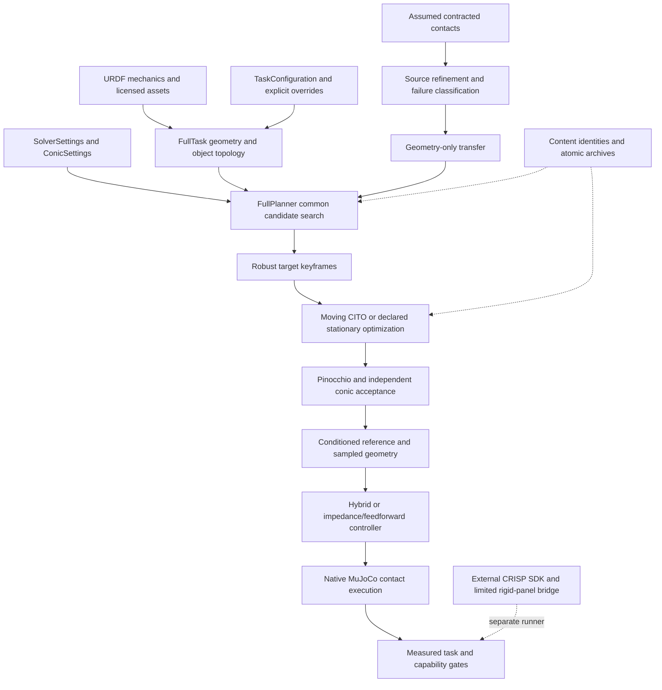

# Framework alpha validation — 23 November 2026

The upgrade makes the common pipeline installable and separates mechanical
inputs, task policies, numerical settings and execution policies. Three native
MuJoCo tasks pass with the configured impedance/feedforward controller. This is
an alpha research release: a physical execution pass is distinct from a source
refinement certificate, literal manuscript compliance and hardware qualification.

The reference revision is `4446273fa12645584a465969992db1a0e457da67`.
[Machine-readable evidence](validation/framework_upgrade_2026-11-23/summary.json)
records tested input/code hashes, cold planning, replay provenance, failed
trials and the environment. The manuscript comparison uses the existing
11-page PDF equation audit, SHA-256
`03deabc2ff306db8582cda6ab24becab4e6681397ab4a5a4367c55ca7d9fe3ba`.



The dotted CRISP path is an implementation option, not a cross-engine result
in this evidence bundle.

## Changes in order

1. **Cache correctness.** A source JSON modification previously left the cache
   identity unchanged. Schema 2 includes referenced contents, mechanics,
   resolved policies, solver settings/libraries and package source. Dependent
   stages include their actual previous keyframe/endpoints. Archive reuse
   requires matching manifests, endpoints and current timing bounds. Atomic
   writes preserve the previous complete numeric archive on interruption.
2. **Common algorithm versus experiment configuration.** `TaskConfiguration`
   holds source/target trust regions, disturbance image, phases, integration
   variant and execution gains. `SolverSettings`/`ConicSettings` hold numerical
   choices. URDFs retain mechanical authority; task adapters retain topology,
   features, geometry, fixtures and keyframes. Existing assumptions are now
   inspectable, rather than silently removed or presented as a generic proof.
3. **Failure classification.** Source failures distinguish necessary wrench-span
   insufficiency, local/numerical NLP rejection and frozen-anchor conic results.
   An unavailable backend fails explicitly. `geometric_prior` is an explicit
   task policy and never becomes a source certificate.
4. **Equivalent numerical improvements.** Static target torques are eliminated
   algebraically for coordinate-selector actuation maps. Torque bounds and the
   unactuated balance remain. Sparse block conic assembly replaces per-vertex
   sparse conversions. Identical source problems and symbolic mechanics graphs
   are memoized with content identity and independent mutable state.
5. **Reference conditioning.** Each optimized time cell is subdivided directly.
   The mesh retains every optimizer time node and its velocity exactly; joint
   configurations remain subject to the reported bounded IK projection. This
   removes nearly coincident time samples introduced by
   merging floating-point clocks; it does not relax dynamics or force limits.
6. **Backend and distribution interface.** IPOPT/Clarabel remain defaults;
   SNOPT/SCS are explicit alternatives. FATROP requires experimental opt-in
   and isolated qualification. The wheel includes CLI, profiles, URDFs and
   notices; large web recordings and external SDKs are excluded. Original
   code is Apache-2.0; upstream model licenses remain in force.

## Solver map and measured optimization

| Stage | Implementation | Scope |
|---|---|---|
| Source refinement / coupled target | CasADi + IPOPT; optional SNOPT plugin | Nonlinear contact positions/normals, posture, robust vertices |
| Fixed geometry wrench margin / allocation | SciPy sparse + Clarabel; optional SCS | Same circular friction cones and independent unscaled residual gate |
| P/G and arm assignment | Restricted explicit enumeration in `FullPlanner` | Hardware-compatible candidates; fixed assignment through the sequence |
| Moving transition | CasADi + IPOPT restricted CITO | Disclosed contact candidates and midpoint variant |
| Stationary holding / handoff | Clarabel conic QP | Fixed configuration, optimized reaction/impulse distribution |
| Stationary object, arm release | CasADi + IPOPT | Object stays stationary; release motion optimized |
| Mechanics acceptance | Native Pinocchio + NumPy + independent Clarabel | Dynamics, closure, torque and fixed-rho witnesses |
| Physical execution | MuJoCo + Python controller | Measured poses, contacts, jaws, actuation and sampled interface wrenches |

Five warm repetitions compared the original and rewritten conic assembly in
the same process, with identical inputs and Clarabel. These are small fixed
geometry calls, not a full-task speedup claim.

| 64-vertex problem | Original median | Current median | Speedup | Margin difference |
|---|---:|---:|---:|---:|
| Three point contacts | 67.45 ms | 10.54 ms | 6.40× | 0.0 |
| Two grippers, one point | 55.13 ms | 8.79 ms | 6.27× | 0.0 |

Symbolic graph construction measured 46.95 ms fresh versus 0.249 ms cached;
this only measures construction. A formerly rejected panel target keyframe
passed in 18.26 s after exact static-torque elimination, with independently
validated `rho=8.081945`. A direct speedup ratio is inappropriate because the
original solve exhausted its iteration budget.

The isolated stationary 8-node CITO qualification accepted IPOPT 2/2 runs.
FATROP aborted inside native code 2/2 runs (exit −6); its small-NLP success is
insufficient qualification. SNOPT is unavailable here. SCS is checked on the
same canonical conic matrices, including rejected infeasible problems; no
full-task speedup or universal robustness advantage is claimed for SCS.

## Cold planning and native execution

All plans below were recomputed with no planning archive hits. The native
results use new executions of those plans with the corrected reference mesh,
the unchanged physical model/acceptance limits, and a 1 ms simulation step.
Replays explicitly report `new_target_solver_executed=false` and
`new_cito_solver_executed=false`; they are not additional cold solves.

| Task | Selected types | Keyframes / intervals | Cold stage cache hits | Largest position error | Largest jaw force over entire trial | Execution |
|---|---|---|---:|---:|---:|---|
| Panel lift, reorient, seat and release | GPP | 9 / 8 | 0 | 1.037 mm | 28.207 N | PASS |
| Floating box and passive lid hinge | GPG | 8 / 7 | 0 | 1.606 mm | 24.385 N | PASS |
| Tabletop and independent leg assembly | GPG | 10 / 9 | 0 | 1.055 mm | 28.550 N | PASS |

The jaw limit remains 40 N per jaw. Object poses are not prescribed and no
object-to-tool equality constraints are used. Internal Robotiq mechanism
equalities are present. Native task completion, loaded contact retention,
actuator limits, sampled interface capabilities and reference geometry all
pass. Minimum actuator margin reaches zero in panel/assembly; these trials do
not establish positive actuator reserve at every instant.

Panel motion ends supported by the jig with all tools released. Box hinge error
is 0.001839 rad. Assembly insertion is 25.001 mm with 0.910 mm lateral error,
followed by leg release. All moving-object intervals use CITO; stationary
holding/handoff and release methods are listed separately in the evidence.
Assembly interval 3 failed at 16 nodes and passed the declared 32-node retry;
the failed attempt remains recorded.

### Reference defect and time-step comparison

The old box reference had a minimum spacing of approximately **0.74 ns** and
an artificial acceleration peak of approximately **2132 rad/s²**. An otherwise
passing trial exceeded the 40 N jaw limit for one frame, reaching **44.761 N**.
Halving only the physics step made the old reference reach **66.896 N**, still
failing. This was a reference-generation numerical defect; a smaller physics
step did not repair it.

The conditioned box reference has minimum spacing 15.625 ms and maximum joint
acceleration 3.837 rad/s². Its 1 ms and 0.5 ms executions both pass, with largest
position errors 1.606 mm and 1.590 mm and all-time jaw peaks 24.385 N and
24.394 N. These two samples are a sensitivity check, not a convergence proof.

### Low-level control

All quantities below use the repository's angular-first, power-dual frame
conventions. Reactions `lambda` are object-on-robot. With contact-coordinate
Jacobian `Jc`, selection projectors `Sf` and `Sm=I-Sf`, reference-relative
velocity `ev`, and force error `ef=Sf H(lambda_measured-lambda_desired)`,

```text
u_m = Sm (K_m e_x + D_m e_v)
u_f = Sf clip(K_f e_f + K_i integral(e_f) + D_f e_v)
tau = clip(M(q) a_d + h(q,v) - J(q)^T lambda_desired
           + Jc^T (u_m + u_f)
           + N^T (K_q(q_d-q) + D_q(v_d-v)))
N = I - M^-1 Jc^T (Jc M^-1 Jc^T + epsilon I)^-1 Jc
```

The force integrator freezes under actuator saturation. Force axes have
velocity damping without position stiffness. Default full-task control uses
`Sf=0`: planned reaction feedforward, Cartesian motion feedback and nullspace
joint impedance, with a separate measured jaw-force loop. Joint gains are
40/8. This execution controller is an addition to the planner, not an equation
claimed to occur verbatim in the manuscript.

In the hybrid profile, **P tools** select their contact-normal force axis.
**G tools** retain Cartesian pose impedance and their separate measured jaw
force loop. The reported episode-level hybrid flag does not mean that all six
axes or every gripper arm use Cartesian force feedback.

Hybrid qualification used the same optimized plans and unchanged acceptance
limits. A contact-normal damping of 40 N·s/m failed the panel's 8 mm tracking
gate (18.538 mm peak), while 80 passed at 6.947 mm. The selected common value
160 was then applied unchanged to box and assembly:

| Task, hybrid feedback at 160 N·s/m | Largest position error | All-time jaw peak | Execution |
|---|---:|---:|---|
| Panel | 3.352 mm | 34.542 N | PASS |
| Box | 1.829 mm | 24.382 N | PASS |
| Assembly | 1.665 mm | 28.640 N | PASS |

This is one nominal trial per task, not a disturbance or hardware stability
certificate. The failed 40-gain run remains failed. The shared qualified
override is packaged as `scenarios/panda_hybrid_control.json`; base task
profiles retain impedance/feedforward for backward compatibility. From a
checkout, use:

```bash
contact-transfer run --task panel \
  --configuration src/contact_transfer/scenarios/panda_hybrid_control.json \
  --output outputs/panel-hybrid
```

Installed packages can obtain that path with
`importlib.resources.files('contact_transfer').joinpath('scenarios/panda_hybrid_control.json')`.
The lower-level controller's default gains are not a qualification of another
arm/contact model.

Raw contact-normal force RMSE also improves in these trials:

| Loaded P interface | Impedance/feedforward | Hybrid at 160 N·s/m |
|---|---:|---:|
| Panel, left support | 0.086 N | 0.0057 N |
| Panel, right support | 0.182 N | 0.0069 N |
| Box support | 0.414 N | 0.0169 N |
| Assembly support | 0.179 N | 0.1217 N |

These are postprocessed raw measured-minus-planned errors after preparation
plus 0.1 s, during holding with planned normal force above 0.1 N. They are not
an extra acceptance threshold. Assembly still has an approximately 2.92 N peak
error, so small RMS error does not imply uniformly precise force tracking.
See [force-error evidence](validation/framework_upgrade_2026-11-23/normal-force-errors.json).

RB/UR position-controlled paths use a virtual admittance
`M_a vdot_a + D_a v_a = ef`, discretized with passive midpoint integration,
followed by bounded differential IK and the manufacturer's inner position
servo. That virtual-system energy property is not a passivity guarantee for
the full moving-contact robot, saturation or MuJoCo's multibody integrator.
The full three-task qualification in this report uses torque-controlled Panda
arms; it does not qualify RB/RBY1/G1 hardware or movable-base execution.

## What is still outside the certificate

The panel has successful source certificates at all 9 keyframes. The box has
0/8 and the assembly 0/10, and their configured geometric-prior fallback is
visible in the outputs. Assembly's P-only small-source model is structurally
insufficient: two tabletop points span at most five wrench dimensions and
one leg point at most three, while each requested image has rank six. Changing
NLP tolerances cannot repair this. More physically justified source contacts
or a justified smaller task load image are needed to validate that source
stage. No such experimental inputs were silently changed in this upgrade.

Inputs remain assumed synthetic contracted contacts; learned contraction was
not executed. Midpoint variants, box articulation and independent multiple
objects are disclosed extensions; `full_paper_pipeline_executed` and
`manuscript_literal_equations_passed` remain false where appropriate. Geometry
and native wrench checks are sampled, not continuous certificates.

CRISP has a Python adapter and C++ CANAL/SubADMM bridge. It is not used by the
three full tasks. Its external SDK/binary is absent here, and the current
bridge covers fixed-base torque Panda plus one rigid panel, excluding native
Robotiq closed loops, floating articulated boxes and assembly. The existence
of that adapter is not a successful CRISP run or cross-engine validation.

Historical ablation and robustness recordings retain their original provenance.
They were not all regenerated by this upgrade. Controller/reference changes
can affect those results, so a current margin-versus-no-margin paper figure
must be regenerated with identical current conditions and loads inside the
declared optimized polytope.

## Reproduce and distribute

The final full regression run passed **224 tests** in 687.36 s. The shared
hybrid-profile test added after that run's collection passed separately, giving
225 distinct passing tests in the current tree; the focused final regression
set passed 59 tests. Warnings were the existing AnyIO/pytest deprecation and
Euler serialization gimbal warnings. Analytical fixed-margin, dual-arm and
three-arm examples also ran. The dual-arm example still explicitly reports
its source fallback rather than claiming a source certificate.

An actual wheel installation outside the checkout passed CLI configuration,
the analytical refinement example, backend diagnostics, packaged hybrid
profile loading, pinned-asset checks and native scene construction. For all
three full robot trees, MuJoCo versus Pinocchio gravity differences were below
`6e-15`. The wheel includes upstream model licenses and the aggregate SPDX
expression. These checks do not qualify a CRISP binary or hardware.

See [deployment instructions](framework-deployment.md) for a checkout-to-wheel
installation and configuration overrides. Solver qualification and the
equivalent conic benchmark are executable tools:

```bash
python tools/benchmark_cito_solvers.py --repeats 2
python tools/benchmark_framework_upgrade.py --help
contact-transfer assets
contact-transfer run --task panel --output outputs/fresh --variants full
contact-transfer run --task box --output outputs/fresh --variants full
contact-transfer run --task assembly --output outputs/fresh --variants full
python tools/validate_execution_variant.py --root outputs/fresh --task box \
  --output outputs/box-half-step --timestep 0.0005
```

No registry publication is implied. Apache-2.0 covers the original code;
existing model licenses, including the GPL-3.0-or-later KUKA URDF, remain.
Wheel SPDX metadata therefore lists the combined code/model conditions.
