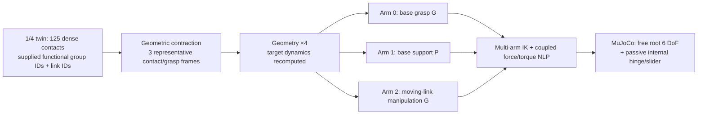
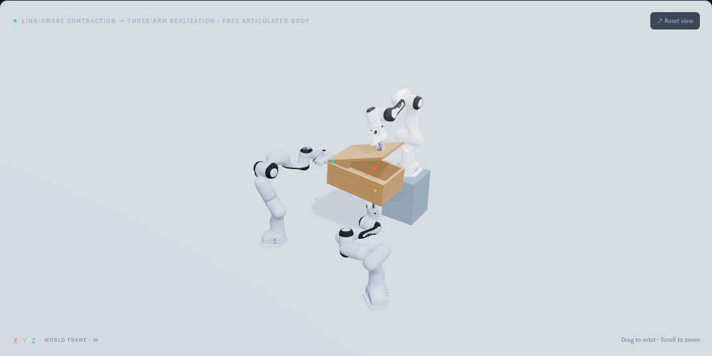

# Free articulated object: link-aware nominal diagnostic baseline

**현재 기록은 명목 경로 진단 baseline입니다. Sec. III-B의 source robust refinement, III-C의 전체 robust posture/geometry realization, III-D의 후보 선택, IV의 CITO를 모두 실행한 기록이 아닙니다. Hybrid force feedback도 이 기록에는 사용하지 않았습니다. 이 상태를 논문 전체 구현 완료로 해석하지 않습니다.**

대표 과제는 세계에 고정되지 않은 박스 본체와 내부 힌지로 연결된 뚜껑입니다.
G/P/G 세 팔이 **본체 파지 / 본체 지지 / 내부 링크 조작**을 각각 담당합니다.
기존 고정 fixture + 단일 팔 과제는 component test이며 이 파이프라인의 증거로 사용하지 않습니다.

## Contact dataflow and its current boundary

현재 입력은 synthetic dense patch와 **주어진 functional group ID**입니다. 네트워크를 실행해
functional grouping을 추론한 결과는 아닙니다. Contraction 자체와 그 결과를 사용하는 target
realization은 실제 실행합니다. G는 양쪽 손가락의 50개 샘플을 하나의 grasp frame으로,
P는 평면 patch의 25개 샘플을 하나의 표면 접촉점으로 모읍니다. 서로 다른 링크의 샘플을
하나의 world-frame 중심으로 섞지 않습니다.

~~~math
\bar p^s_g=\frac{\sum_{j\in g}w_j p^s_j}{\sum_{j\in g}w_j},\qquad
c_g=(\ell_g,\mathrm{role}_g,\mathrm{kind}_g,\bar p^s_g),\qquad
p^t_g=4\bar p^s_g.
~~~

대표 접촉에는 link ID와 기능을 유지합니다. Target의 별도 수동 지정 anchor를 사용하지 않고
source 샘플의 contraction 결과로부터 세 팔의 target을 만듭니다. G anchor는 두 손가락 사이의
가상 grasp frame이며 물체 표면 한 점으로 해석하지 않습니다. Normal/approach metadata와
injective arm assignment, 경로는 주어진 입력입니다. 이것은 학습 기반 grouping 성능이나
분산 접촉 wrench를 정확히 보존한다는 검증은 아닙니다. 실제 시연 및 네트워크 결과를 이 입력에
연결하고 grouping/refinement 비교를 추가해야 논문의 학습 효과를 주장할 수 있습니다.

## Free multi-body dynamics and realization

본체는 freejoint, 내부 링크는 revolute 또는 prismatic 관절입니다. 물체의 독립 좌표는
$q_o\in\mathbb{R}^3\times SO(3)\times\mathbb{R}$이고 속도 차원은 7입니다.
박스 본체와 내부 링크에 actuator, mocap, world-fixed hinge 또는 weld를 두지 않습니다.
초기 파지는 주어진 조건으로, 두 gripper의 손가락을 닫힌 좌표에서 시작합니다. 파지 획득 경로를
시연한 것은 아닙니다. 이후 모든 물체 상태는 접촉 동역학으로 적분합니다.

제공한 root lift/reorientation 및 내부 관절 경로로 각 팔의 IK를 구한 뒤, target URDF의
관성·중력·관절 마찰을 사용해 아래 7개 일반화된 힘 평형과 세 팔의 토크 한계를 함께 풉니다.

~~~math
M_o(q_o)\dot v_o+h_o(q_o,v_o)+\tau_{\mathrm{passive}}
=\sum_{g=1}^{3}J_{o,g}(q_o)^\top w_g,
\qquad
\tau_i=\operatorname{RNEA}_i-J_i^\top\lambda_i.
~~~

$w_g=[m_W;f_W]$는 접촉/grasp frame 원점에서 **물체에 작용하는** world-aligned wrench입니다.
로봇 반력은 $\lambda_i=[-R_{Wi}^{\top}m_W;-f_W]$로 mixed ordering의 power dual을 맞춥니다.
G의 force/moment box와 P의 unilateral Coulomb cone, URDF joint effort/velocity를 제한합니다.
접촉 모드·assignment·root/내부 관절 경로까지 동시에 탐색하는 articulated CITO는 아닙니다.

Link ID를 모두 base로 바꾸는 수치 대조에서는 접촉 map의 rank가 7→6으로 줄고, 내부 관절
방향의 모든 열이 0이 됩니다. 이때 moving-link 조작 토크를 만들 수 없습니다. 이는 link identity를
지워서는 안 된다는 구조적 검사이며, learned functional grouping과 geometric clustering의
성공률 비교를 대신하지 않습니다.

Low-level은 기존 computed torque + Cartesian PD이며, 세 팔 모두 실제 contact force를 통해
하중을 전달합니다. G 손가락의 0.017 m 위치 명령과 6000 N/m servo gain, 구형 공구의
0.2 mm reference preload는 simulation 가정입니다. 구형 공구에는 URDF에 별도 질량·관성을 둔
14 cm standoff를 추가했습니다. 로봇 본체의 vendor mechanics는 바꾸지 않았습니다.
두 G의 grip retention은 양쪽 손가락 접촉을 모두 확인합니다.

## Three object variants

- **박스 + 뚜껑:** 자유 hollow box를 두 팔이 지지하고 세 번째 팔이 뚜껑을 0→60° 엽니다.
- **접이식 물체:** 자유 얇은 panel을 지지하고, 아래로 접힌 wing을 90→0°로 펼칩니다.
- **이동 가능한 수납함 + 서랍:** 자유 cabinet shell을 지지하고 내부 tray를 0→180 mm 당깁니다.

각 18초, 6 keyframe입니다. 2–4초에 본체를 25 mm 들어 5° 재배향하고, 5–13초에 내부 관절을
움직인 후 18초까지 유지합니다. 본체와 내부 링크 질량·관성은 authored target URDF에서 읽습니다.
실물 물성을 보정한 digital twin은 아닙니다. 내부 parent-neighbor 충돌 제외와 native 관절 stop을
사용하며, 뚜껑 닫기·삽입 시 걸림·접촉 stop의 충실도는 이 opening/unfolding 실험으로 검증하지 않습니다.

| Task | 최종 관절 오차 | 본체 최대 위치 오차 | 세 팔 접촉율 | 판정 |
|---|---:|---:|---|---|
| free_box_lid | 0.1252 deg | 0.0657 mm | [1.0, 1.0, 1.0] | PASS |
| free_folding_object | 0.1639 deg | 0.1545 mm | [1.0, 1.0, 1.0] | PASS |
| free_portable_drawer | 0.0568 mm | 0.0799 mm | [1.0, 1.0, 1.0] | PASS |

실행 판정은 최종 hinge 오차<2° / slider<12 mm, 본체 위치<20 mm·회전<0.1 rad,
세 팔의 접촉율>95%, actuator 한계 및 비의도 penetration 검사를 포함합니다.
이번 baseline은 모두 접촉율 100%였고 비의도 penetration은 검출되지 않았습니다.
Pinocchio와 native MuJoCo의 7D object M/gravity/contact Jacobian을 독립 비교했으며,
새 standoff를 포함한 세 팔의 M/gravity도 비교합니다. 연속 형상 안전성 인증은 아닙니다.

## External-force visualization and controls

자유 박스 본체에 world-Y 5 N peak, sin² profile, 8–9초의 외력을 적용했습니다.
본체의 최대 위치 오차는 0.5523 mm, 세 팔 접촉율은 모두 100%, 전체 PASS였습니다.
로봇–물체 contact를 끈 대조에서는 본체가 바닥으로 떨어지고 최대 위치 오차 475 mm,
뚜껑 목표 오차 약 60°로 FAIL입니다. World anchor로 본체를 붙잡지 않았다는 실행 근거입니다.
한 방향·시점·크기의 결정론적 시험이며 robust 성능 보장은 아닙니다.

뷰어에서 **외력 최대 · 화살표 · 8.5 s**를 누르면 해당 시점에 정지하며, 실제 작용점을 따라가는
빨간 화살표와 world-frame force 크기를 표시합니다. Depth occlusion을 피하고 CPU fallback에도
화살표를 그립니다. 기존 RBY1 pulse 기록에도 16.25초의 같은 이벤트를 추가했습니다.
접촉 표시는 dense patch / contracted anchor / 둘 다 / off를 선택할 수 있으며 링크와 기능별 색상을
유지합니다. 그림은 실제 URDF/mesh와 native 실행 좌표입니다.

~~~bash
OPENBLAS_NUM_THREADS=1 python tools/run_free_articulated.py --all --viewer web
# 외력/접촉 제거 비교는 baseline과 별도 output/viewer에 저장:
OPENBLAS_NUM_THREADS=1 python tools/run_free_articulated.py --push 5 --output outputs/forced --viewer outputs/forced/viewer
OPENBLAS_NUM_THREADS=1 python tools/run_free_articulated.py --no-contact --output outputs/no_contact --viewer outputs/no_contact/viewer
npm --prefix web run build
python web/server.py --port 8011
~~~

로컬 API는 `{"preset":"free_box_lid","duration":18}`를 받습니다. 선택적으로
`dense_source_groups`를 전달해 같은 파이프라인을 실행할 수 있습니다. JSON에 임의의 파일 경로나
물체 actuator를 전달할 수 없습니다. 무료 GitHub Pages는 실제 기록과 contraction 결과의 재생용이며
새 최적화·동역학 계산은 Python backend에서 실행합니다.
