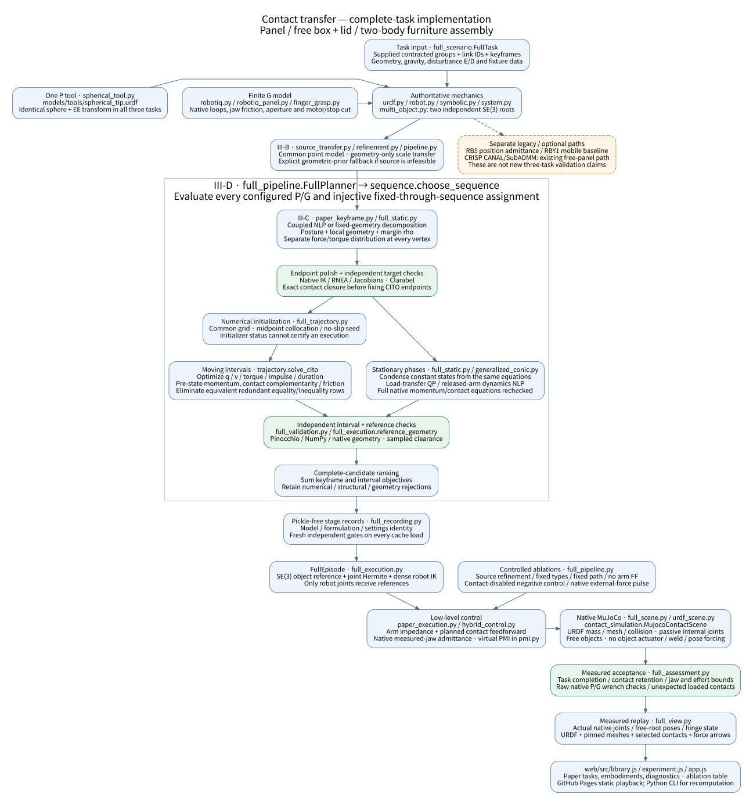

# Full-scenario integration contract and execution ledger

Requested scope: furniture/table assembly, free box/lid opening, and panel
reorientation/placement/release. This file tracks implementation rather than
asserting an unexecuted full-pipeline result. The consolidated historical
[architecture report](system-architecture-and-progress.md) describes baseline
`5ad6015`, whose 131 Python and 33 browser checks passed before this work.

## Required common behavior

- All P tools are compiled from `models/tools/spherical_tip.urdf`: identical
  25 mm sphere, stem, inertia and EE-to-leading-contact-frame transform
  `[0,0,0.165] m`, identity rotation. Task orientation is not a mount bias.
- Functional groups are supplied; source refinement is executed on actual
  surface candidates. No learned inference is invented.
- Type and injective robot-assignment candidates must be evaluated and their
  rejections retained. A prescribed G/P/P or G/P/G record is not an optimized
  type-selection result. Inaccessible gripper geometries are explicitly
  inapplicable, not silently treated as point tools.
- Every accepted candidate must include all task keyframes and intervals,
  object/environment or inter-object load transfer, unload/release where
  applicable, finite grip forces, independent mechanics/capability checks,
  sampled geometry and native closed-loop execution. No nominal-path fallback
  may be labeled a passed CITO result.
- The manuscript is single-rigid-body; box internal joints and two independent
  assembly bodies are documented extensions. Integration variants and
  reference interpolation are recorded, not silently called literal Eq. (17).

## Ablation contract

| ID | Change from full method | Common quantities |
|---|---|---|
| `full` | source refinement, robust target, type selection, interval optimization, native execution | task geometry/mass, keyframes, candidate budget, tolerances and controller settings recorded |
| `no_source_refinement` | supplied source surface positions fixed | target solver and selection procedure unchanged |
| `fixed_contact_types` | task's supplied type/assignment replaces search | same endpoints/transition validator and robot limits |
| `fixed_path` | prescribed interpolated robot/object path, optimize reactions/torques only | selected tools and endpoints match full method; explicitly a reduced baseline |
| `no_arm_force_feedforward` | replay full plan with arm feedforward reaction set to zero | same pose/joint impedance and gripper squeeze loop |
| `contact_disabled` | robot-tool/object collision disabled | same plan/commands; negative physical control, expected task failure retained |
| `external_push` | inject 5 N for one second using the native force API | same optimized plan, controller gains and physical limits; replay arrow retained |

Trials record success/failure, task-end pose/insertion/hinge metrics, contact
retention, effort/jaw bounds, wrench-capability violations and planning time.
No wall-time improvement or success rate is inferred from one nominal run.
External-force trials use actual native force injection and replay arrows.

## Current work

| Item | Status |
|---|---|
| Baseline regression and architecture report | saved at `cd638a7` |
| Canonical P tool compiler / cross-scenario EE-bias check | implemented; focused check passed |
| Independent two-free-body mechanics / both quaternion integrations | implemented; focused check passed |
| Internal-contact equal/opposite impulse and power/gap checks | implemented; focused check passed |
| Target keyframe unload force flag and source-refinement switch | implemented; focused validation in progress |
| All three task adapters / scenes / independent native mechanics | implemented; three-scene mass/gravity checks passed |
| Robust target keyframes | panel 9, box 8 and assembly 10 declared keyframes; individual/sequence acceptance is recorded separately |
| Type/assignment optimization connected to complete scenarios | implemented; exhaustive configured candidates, rejections and common sequence objective retained; assembly: 24 configured candidates, one accepted G/P/G sequence; panel/box complete acceptance remains pending |
| Full native executions / ablation matrix / web records | assembly full native execution and URDF web replay passed; remaining full tasks and controlled ablations in progress |

The ledger is updated from executed results. Pending cells must not produce
`full_paper_pipeline_executed=true` in public recordings.

## Current implementation and reproduction

`tools/run_full_scenarios.py` is the common entry point. `full_scenario.py`
defines tasks, source priors and native tool capabilities; `full_pipeline.py`
connects actual keyframe/interval solvers to `sequence.choose_sequence`.
`full_scene.py`, `full_validation.py`, `full_execution.py` and
`full_assessment.py` keep scene construction, independent planning validation,
closed-loop execution and measured task acceptance separate. `full_view.py`
exports measured native joints/root poses and the ablation table.

```bash
OPENBLAS_NUM_THREADS=1 .venv/bin/python tools/run_full_scenarios.py \
  --tasks panel box assembly --output outputs/full_scenarios --web web
```

Default variants are `full`, `no_source_refinement`, `fixed_contact_types`,
`fixed_path`, `no_arm_force_feedforward`, `contact_disabled`, and
`external_push` (5 N, one-second sin-squared native force pulse). Failure is a
retained trial result, not a substitute for a passed full-method trial.
`fixed_path` reports its integration defect and never claims interval CITO.
An absent accepted full plan blocks its dependent controller ablations.

Numerical changes preserve the physical gates:

- P and finger Coulomb forces can use `f=[mu*n*t_x,mu*n*t_y,n]`,
  `n>=0`, `||t||<=1`: the same circular cone with a nonsingular normal bound.
- Moving intervals use independent midpoint configuration updates, pre-state
  momentum, exact unrelaxed contact checks, and a Huber tangential-speed norm with a recorded 1e-6 m/s smoothing speed. The final acceptance gate separately checks the original unsmoothed maximum-dissipation work.
- Declared stationary phases condense their constant states from those same
  equations and solve the torque/finger-witness objective as a conic QP, including the last zero robot load at handoff. Open the gripper during a stationary 0.8 s dwell, then optimize the released arm trajectory with full joint dynamics while the supported object/holding-arm coordinates are fixed in the planner. These coordinates remain free in MuJoCo. Methods are recorded as `stationary_contact_conic_QP` and `stationary_objects_release_NLP`, separately from moving-object CITO.
- IPOPT primal acceptance remains 2e-6; acceptable termination additionally
  requires unscaled constraint violation <=1e-6. Objective/KKT acceptance is
  configured separately (1e-4), and final independent unrelaxed gates remain
  mandatory. A maximum-iteration result is never accepted directly.
- If maximum-margin Clarabel terminates with a numerical error, the same
  requested rho can be certified by a strictly convex fixed-rho witness QP.
  Both statuses are retained; rho is not silently reduced.
- Fixed-endpoint closures are polished with native IK and every vertex's
  torque is recomputed and rechecked. Analytically redundant endpoint rows,
  the inequality `gap>=0` alongside `gap=0`, and a holding-aperture lower bound
  alongside its exact fixed value are eliminated. Their physical feasible
  set is unchanged; the barrier problem gains strict feasibility.

The common moving-interval grid is now 16 nodes. A separate kinematic seed
solve precedes dynamics: the box lift's minimized required grasp-velocity
band was 2.34e-5 at 8 nodes and below 1e-7 at 16/32 nodes. This diagnostic
does not replace CITO. The corrected 16-node box lift has subsequently
terminated successfully as a full motion-cost CITO NLP and passed native
MuJoCo tracking/contact, finite jaw/actuator and sampled wrench checks.
That prefix does not constitute the complete box-opening task.

The full-task Robotiq model uses the tested 40 N/jaw operating point and a
native virtual-work cut for its finite 5 Nm transmission and unilateral
coupler stops. This replaces the older first-lift demo's declared 60 N box
for these new experiments; it is still an authored simulation model, not
a complete hardware capability calibration.

Stage caches carry model/formulation identities. `--keyframe-archive` is an
explicit option to reuse earlier optimized keyframes only after matching
mechanical URDF bytes, task/mode and source prior, and rerunning native
equilibrium, capability, frozen-conic and geometry checks. Archive reuse and
fresh solve wall times are distinguished. Failed `*-unaccepted.npz` files
can initialize a new solve but cannot pass any stage by themselves.

## Current code structure



The source diagram is [full-scenario-flow.dot](diagrams/full-scenario-flow.dot).
All P tools use five-dimensional pose IK (position plus tool axis); axial roll is free. This avoids prescribing an extra contact moment or unnecessary wrist rotation. Native geometry still checks the stem and arm meshes.

Moving-interval grids adapt uniformly from 16 to 32 to 64 nodes. The default per-NLP CPU budget is 180 seconds for every variant; failed and budget-exhausted attempts remain in `interval*-mesh-attempts.json`. Finite failed iterates may seed a fresh successful solve, never certify a plan. Cached solves and fresh solves are reported separately.

## Fixed-geometry target decomposition and numerical boundary checks

Held material points are fixed after their first realization. At such a keyframe,
contact geometry and capability maps no longer depend on robot posture. The
implementation first minimizes the posture term with the same contact closure
and axis constraints, then computes a torque-free SOCP upper bound on rho.
If a separate fixed-rho SOCP realizes that **same** upper bound at that posture
with every joint torque limit, both separable objective bounds are attained.
The target certificate records these two successful solves. If the bound is
not torque-realizable, the coupled target NLP remains the fallback. No global
optimality is asserted for the nonconvex posture IK.

After native endpoint IK polish, a successful fixed-rho witness QP may replace
static force distributions without changing pose, rho or the target objective.
If this auxiliary solve is rejected, its iterate is discarded and the original
successful target solution must pass the fresh independent gates instead.

`FingerGrasp.check` first tests exact wrench equality. At a numerically rounded
cone boundary, it can instead find an actual cone/capacity witness within half
of its existing 1e-7 wrench test tolerance. The returned residual is still
checked against that same tolerance; a 1e-3 overload is rejected by a dedicated
regression test. Failed conic iterates never serve as witnesses.

Assembly shoulder candidates use the exact parameterization
`P=[mu*n*t_x,mu*n*t_y,n]`, `n>=0`, `||t||<=1`, with a recorded 1e-6 ratio
regularizer. This removes the quadratic cone's zero-gradient vertex when an
insertion candidate has zero load. Original unsmoothed Coulomb and momentum
checks remain independent final gates. This change enabled the complete
16-node insertion interval to terminate successfully; its native execution
still has a separate acceptance requirement.

## Reference geometry and layout

A released gripper is checked in its native URDF open configuration after its
stationary opening dwell. The previous closed-jaw geometry is retained for
holding. The recording always exports measured native gripper joints,
including passive links; it does not animate a scripted opening over the trace.
Objects remain free during both planning-reference checks and native execution.

The full panel task has a separate authored layout in
`src/contact_transfer/scenarios/full_layouts.json`. Robot 0 is placed at
x=-0.75 m to accommodate the actual Robotiq tool through placement. A sequential
IK diagnostic increased the smallest joint-limit margin from 0.00034 rad at
the legacy placement to 0.164 rad. All contact types and ablations use the same
new layout. Canonical spherical tip geometry and its EE bias are unchanged.

Dense reference interpolation can be cached only with matching model, plan,
reference spacing and interpolation-code identities. Robot velocity bounds and
native geometry are checked again before execution. This cache contains no
physical execution or success certificate.

The panel layout also declares `posture_reference_rule=previous_keyframe`.
Every method uses that same rule. Independent keyframe posture minimization
against the original hardware seed had selected a different wrist branch
between two neighboring poses (a 4.49 rad joint change); its transition
initializer was infeasible. Using the preceding realized posture as the
regularization reference retains the contact geometry and torque/force
constraints while favoring a continuous branch. Box and assembly retain the
hardware-seed reference. The rule and reference vector are stage metadata;
old target solutions with a different rule are not reused for later keys.

## First accepted complete task: furniture assembly

The 30.4 s native MuJoCo run in `outputs/full_scenarios_v15/assembly/full` passed every declared gate. All ten keyframes and nine intervals passed independent mechanics and sampled geometry. Selection evaluated 24 configured type/assignment candidates and retained G/P/G with assignment 0/1/2. Every interval used 16 nodes. The strict original momentum equations and zero-defect independent midpoint configuration update were retained.

Measured insertion depth was 25.0014 mm and lateral error 0.4535 mm. Maximum tabletop/leg tracking errors were 0.539/0.667 mm. All three required-contact fractions were 1.0. Peak measured jaw reaction was 32.096 N against the tested 40 N/jaw operating bound. All 1,641 sampled native interface resultants passed the finite capabilities; no unexpected loaded contact occurred. The leg gripper released and the tabletop supplied 3.92401 N of support for a 3.924 N leg.

[Measured recording](../web/data/full_assembly.json) preserves the selected types, margins (minimum target rho 0.35431), actual passive gripper joints, free-body poses and independent acceptance report. Source point-model refinement used the explicit geometric fallback; this result does not claim successful source robustness refinement or learned network inference. The current public record contains the completed full trial; ablation rows are added only as their trials finish.
