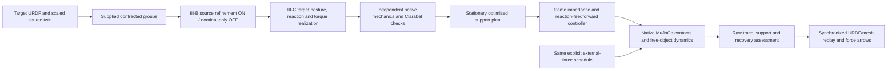
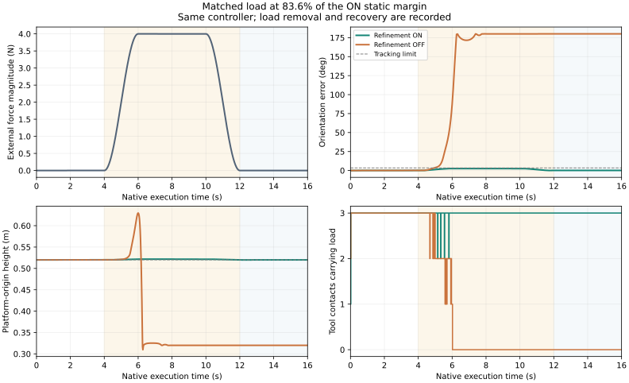

# Inside-margin loading: bounded tracking versus persistent loss of support

The matched slow-load comparison now shows three Panda arms retaining a free
loaded platform with robust source refinement, while the nominal-only source
loses support and overturns under the same external load. These are native
MuJoCo trajectories, not prescribed object animation. The result is a
finite-time loss of support, not a mathematical divergence theorem.

## Task, optimizer, and controller

The rigid platform has a fixed upper payload, total mass 2 kg, and COM
`[0, 0, 0.2005] m` relative to the platform origin. Three rigidly joined boxes
define its visual/collision geometry, mass, COM, and parallel-axis inertia in
`scenarios/margin_platform/panel.urdf` and `design.json`. It is one free rigid
body, without an object actuator, mocap constraint, or world weld. Three Panda
arms use the existing common spherical tool: radius 25 mm, EE-to-tip 165 mm.

Contracted groups are supplied synthetic inputs. Source refinement uses the
same geometry penalty and constraints in both conditions; ON includes the eight
task-force-box vertices and the rho objective, OFF keeps nominal equilibrium.
Only contact positions transfer at scale four. The source COM, geometry,
inertia, and mass are scaled from the target URDF; forces are not transferred.
Target robot postures, reactions, and torques are recomputed. Target material
sites are fixed to isolate source refinement. This is a stationary diagnostic,
not a new full-motion CITO or contact-type selection experiment.

Solvers and native integration are unchanged: CasADi/IPOPT for source/posture
NLPs, Clarabel for frozen-contact load allocation and independent certificates;
MuJoCo implicitfast, elliptic friction, 1 ms timestep. The arm controller remains
joint impedance with planned reaction feedforward (`Sf=0`, joint nullspace
K=40/D=8). No gains or controller modes differ between ON and OFF. There is no
measured-force hybrid-controller or hardware-stability claim.



## Certificate and applied load

At the nominal pose, the task set is

```math
\Delta w=E D u,\quad \|u\|_\infty\le\rho_{cert},\qquad
E=\begin{bmatrix}S(r)\\I\end{bmatrix},\quad
r=[0,0.18,0.02]^T\ \mathrm m,\quad D=\operatorname{diag}(2.56,2.56,8)\ \mathrm N.
```

The full wrench includes the lever-arm moment. The accepted target margin is
independently checked at the realized posture; test admission uses the smaller
of the planned and independently checked margin. ON has rho 0.59784752, giving
a vertical bound of 4.782780 N. OFF has independently evaluated rho 0.37681080,
giving 3.014486 N. OFF did not optimize the source disturbance vertices.

The primary applied force is world `[0,0,+4] N`, at the same body point in both
conditions: zero before 4 s, a smooth sin-squared rise from 4–6 s, constant
4 N from 6–10 s, a smooth fall from 10–12 s, then zero through 16 s. Its peak
coefficient is 0.5, or **83.633% of ON's certified box** and 132.693% of OFF's.
An object-only SOCP at this exact signed load is feasible in ON and
`PrimalInfeasible` in OFF. The latter is stronger evidence than merely being
outside OFF's largest homothetic box; arbitrary directions outside a box are
not automatically infeasible. The ON full-box check separately includes arm
torque limits.

| Measured quantity | ON | OFF |
| --- | ---: | ---: |
| Maximum position error | 1.718 mm | 697.079 mm |
| Maximum orientation error | 2.609° | 180.000° |
| Final one-second maximum position error | 0.750 mm | 691.144 mm |
| Final one-second maximum orientation error | 0.103° | 180.000° |
| Final-window three-tool support fraction | 100% | 0% |
| Native execution criteria | PASS | FAIL |
| Recovery after force removal | Yes | No |



## Controls, failures, and limits

All 12 loaded-platform trials are retained: no load, a slow 1 N common-interior
load, a faster 2 N common-interior load, slow 4 N loading, faster 4 N loading,
and four repeated 4 N pulses, each with source robustness ON and OFF. The
flat-panel pair and four compact-payload exploratory trials are also retained.
No native trial is removed because it recovered or failed in both conditions.

The scene and rate selection were exploratory, not preregistered. The original
flat panel recovered in OFF. Fast loading of the tall payload failed even in
ON, despite lying in its initial static box. The faster 2 N condition failed in
OFF inside its own static box. These results expose a dynamic execution limit:
static wrench feasibility does not guarantee that a finite-bandwidth controller
will retain contacts while the object state changes. The slow 1 N control
passes in both conditions. The comparison does not establish stability for
arbitrary disturbance rates, all box vertices, other controllers, or hardware.

“Persistent loss of support” requires more than 50 mm position error or 0.3 rad
orientation error for at least 90% of the final one-second window, three-tool
support for at most 10% of that window, and no recovery to the original
8 mm / 0.06 rad / 99% support criteria. A recovered transient is a separate
outcome. Each condition has one deterministic trial; no statistical success
rate or asymptotic instability is inferred.

## Reproduce and inspect

```bash
OPENBLAS_NUM_THREADS=1 OMP_NUM_THREADS=1 .venv/bin/python tools/run_margin_hold_study.py
OPENBLAS_NUM_THREADS=1 .venv/bin/python tools/summarize_margin_hold.py
MPLCONFIGDIR=/tmp/margin-hold-mpl .venv/bin/python tools/plot_margin_hold.py
```

The runner reuses one realized plan per mode across its force conditions. The
summary verifies identical native case IDs, equal controller configurations,
constant per-mode plan IDs, identical force histories, and raw trace hashes.
The force-arrow profile is checked against saved native schedule samples.
`web/robustness-comparison.html` synchronizes both replays, shows the actual
applied force, and retains all comparison outcomes and exploratory pairs.
Raw execution traces and controller logs remain under
`outputs/margin_platform_v1/<mode>/<condition>/native/`.
