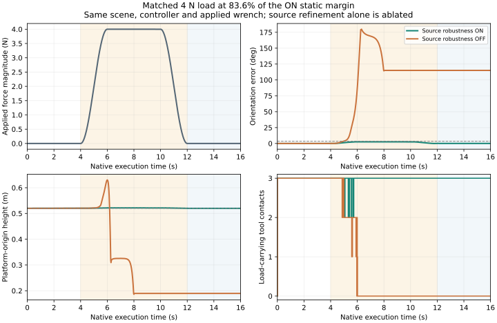

# Measured research-study results — 24 November 2026

One trial per condition. Source model extensions and literal-equation failures are described in [the validation report](research-validation-2026-11-24.md).

## Panel ablations

| Condition | Native checks | Peak position error | Task goal |
|---|---|---:|---|
| full | PASS | 3.965 mm | True |
| no_source_refinement | PASS | 5.657 mm | True |
| fixed_contact_types | PASS | 3.965 mm | True |
| no_target_robustness | PASS | 3.286 mm | True |
| fixed_path | PASS | 1.738 mm | True |
| external_push | FAIL | 11.870 mm | True |
## Box ablations

| Condition | Native checks | Peak position error | Task goal |
|---|---|---:|---|
| full | PASS | 1.723 mm | True |
| no_source_refinement | PASS | 1.878 mm | True |
| fixed_contact_types | PASS | 1.723 mm | True |
| no_target_robustness | PASS | 1.770 mm | True |
| fixed_path | PASS | 2.053 mm | True |
| external_push | PASS | 1.779 mm | True |
## Assembly ablations

| Condition | Native checks | Peak position error | Task goal |
|---|---|---:|---|
| full | PASS | 1.391 mm | True |
| no_source_refinement | PASS | 1.576 mm | True |
| fixed_contact_types | PASS | 1.391 mm | True |
| no_target_robustness | PASS | 0.707 mm | True |
| fixed_path | PASS | 0.593 mm | True |
| external_push | FAIL | 9.640 mm | True |

The full baseline and nominal-only target use different objectives; their raw objective values are not treated as a like-for-like cost comparison. Fixed types equal the selected candidate. Fixed path is a prescribed-path allocation baseline.

## Forced contact types

| Task / types | Stage | Native outcome | Full objective | Evidence |
|---|---|---|---:|---|
| panel / P/P/P | native_execution | FAIL | -30.581447141925608 | Same objective, assignment, source and controller; see the native report |
| box / G/P/P | planning | Not executed | — | no feasible sequence among 1 attempted candidates; Point position/axis IK failed at tip |
| box / P/P/G | planning | Not executed | — | no feasible sequence among 1 attempted candidates; Fixed material geometry leaves target trust region |
| assembly / G/P/P | planning | Not executed | — | no feasible sequence among 1 attempted candidates; Structurally insufficient contact-type wrench span on free leg: maximum rank 3<6 before assembly |

Local IK / trust-region rejection is not global infeasibility. The assembly rank obstruction concerns the required free-body wrench image.

## Mid-task matched probes

Certified fixed-pose margin lower bounds are reported below. A failed maximum-margin solve followed by rho=0 feasibility does not establish zero physical capacity.

| Task | ON lower bound | OFF lower bound | ON / OFF challenge outcome |
|---|---:|---:|---|
| panel | 8.08195 | 7.98385 | bounded_tracking / bounded_tracking |
| box | 18.4432 | 18.4432 | bounded_tracking / bounded_tracking |
| assembly | 7.31977 | 5.82966e-18 | bounded_tracking / bounded_tracking |

## Full tasks with a mid-task load interval

The six-second inserted hold has matched zero-load controls. The 80% ON load is checked at the optimized reference pose. Both tasks then continue to their original goals; this is a measured closed-loop test, not a dynamic certificate.

| Task | Robustness | Pause load | Native checks | Hold peak position error | Recovered during hold |
|---|---|---|---|---:|---|
| panel | ON | nominal | PASS | 2.263 mm | True |
| panel | ON | challenge | PASS | 2.360 mm | True |
| panel | OFF | nominal | PASS | 1.664 mm | True |
| panel | OFF | challenge | PASS | 1.794 mm | True |
| box | ON | nominal | PASS | 1.383 mm | True |
| box | ON | challenge | PASS | 2.792 mm | True |
| box | OFF | nominal | PASS | 1.797 mm | True |
| box | OFF | challenge | PASS | 2.518 mm | True |
| assembly | ON | nominal | PASS | 0.439 mm | True |
| assembly | ON | challenge | PASS | 1.180 mm | True |
| assembly | OFF | nominal | PASS | 0.237 mm | True |
| assembly | OFF | challenge | PASS | 1.082 mm | True |

The box opposite-direction probe fails ON tracking despite an inside-box 80% load; contact and force/torque admissibility still pass. This retained counterexample limits a closed-loop robustness claim and motivates measured-load redistribution/control qualification.

## Source-refinement robustness contrast

| Load | Refinement | Load / own static margin | Native checks | Measured outcome | Tail position error |
|---|---|---:|---|---|---:|
| nominal | ON | 0.000 | PASS | bounded_tracking | 0.040 mm |
| common_up1 | ON | 0.209 | PASS | bounded_tracking | 0.040 mm |
| slow_up4 | ON | 0.836 | PASS | bounded_tracking | 0.754 mm |
| nominal | OFF | 0.000 | PASS | bounded_tracking | 0.035 mm |
| common_up1 | OFF | 0.332 | PASS | bounded_tracking | 0.310 mm |
| slow_up4 | OFF | 1.327 | FAIL | persistent_loss_of_support | 470.657 mm |

The primary 4 N load is 83.63% of the ON certified static box and 132.69% of the OFF certified lower-bound box. ON recovers; OFF retains a finite-time loss of support. Both pass no-load and common 1 N controls. The source protocol is an exploratory scene/rate design whose historical alternatives remain available; it is not a statistical or asymptotic-stability result.
