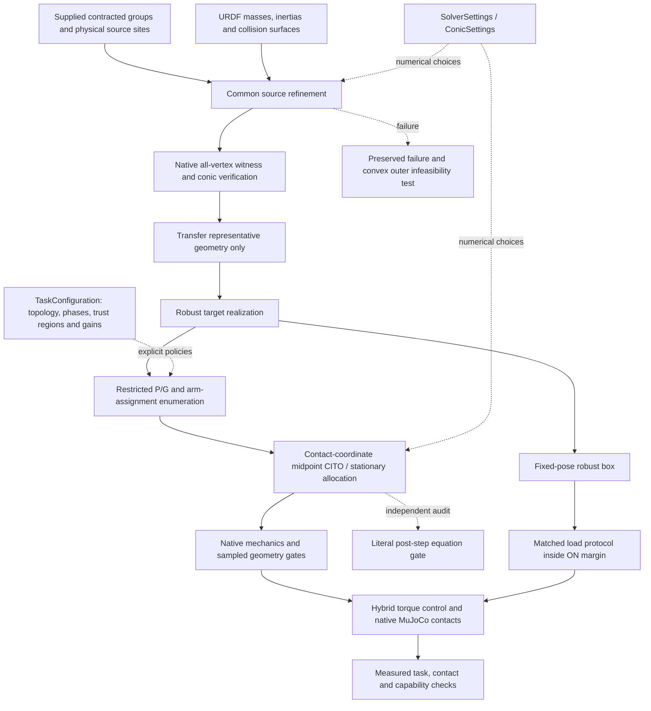

# Source certificates, formulation scope, and controlled validation

Release: **0.2.0a2**, based on `41008fa7af5ea2f77ee1b24538e224968748f5dc`.
This implements the next four research-validation steps after the
[framework alpha upgrade](framework-upgrade-validation-2026-11-23.md).
The [numeric evidence bundle](validation/research_2026-11-24/summary.json)
contains input/code hashes, accepted plans, rejected solves and measured results.
One trial per condition is reported; these are not statistical success rates.
The [measured tables and response plot](research-study-results-2026-11-24.md)
include every controlled native trial and the retained counterexamples.

The manuscript reference is the existing audit of the supplied 11-page PDF,
SHA-256 `03deabc2ff306db8582cda6ab24becab4e6681397ab4a5a4367c55ca7d9fe3ba`.
The PDF was not available for reopening in this workspace. Supplied synthetic
contracted contacts are used; learned inference and hand-demonstration
contraction are **not** executed by this study.



## 1. Source refinement: numerical failure versus physical impossibility

The historical box and assembly fixtures contain three representative P
contacts. Their failed certificates are retained. They are not relabelled as
successful source refinement after a successful target execution.

`tools/diagnose_source_feasibility.py` constructs a **convex outer relaxation**
of the original nominal source problem over every allowed point displacement.
For a fixed-normal site with `||delta p|| <= r`, the extra generalized moment
in row j obeys

\[
 |\delta w_{ij}| \le
 r\|J_{\omega,i}[:,j]\|_2\sqrt{1+\mu_i^2}\, f_{n,i}.
\]

Independent row errors inside these bounds enlarge the feasible set. Normal
force bounds and circular Coulomb cones are retained. All eight box and ten
assembly poses are infeasible even in this enlargement. Clarabel's returned
dual vector is normalized and independently checked for `A.T z = 0`, dual-cone
membership and `b.T z = -1`. Matrices and dual vectors are archived. This is
evidence of physical infeasibility **for those inputs, fixed normals and trust
regions**, rather than a conclusion drawn from an IPOPT timeout. It is not a
claim about every possible hand grasp or a different source model.

An explicit alternative supplies **19 physical unilateral sites in three
functional groups** for box and assembly. The original three-arm target is
retained. Opposed source patches have separate normal-force budgets; each
site has zero moment and its own circular friction cone. This changes the
physical source contact configuration and total available force; it is not
an equivalent reparameterization of the old three-P fixture. No fictitious
free wrench or scaled source force is passed to the robot.

For group g, each actual surface site is

\[
 p_{gi}(u_g)=\bar p_{gi}+r_g B_g u_g,
 \quad \|u_g\|_2\le1,
 \quad \sum_{gi}W_{gi}(p_{gi})\lambda_{gi}^{(v)}
 =w_0+\rho EDv.
\]

All sites in a group share a tangential displacement. The physical sites and
every chart corner are checked against the source URDF collision surfaces.
Only the representative surface anchor and normal are geometrically scaled.
Target loads, reactions, finite gripper limits and robot torques are solved
again. This **site-level functional-group model is a declared extension** of
the manuscript's one-representative-P refinement, not a literal Eq. (7) result.
Its JSON fixtures explicitly state that no network inference was executed.

The numerical improvements preserve that chosen site's circular force set:

\[
 f_t=\mu f_n z,\quad \|z\|_2\le1,\quad 0\le f_n\le\bar f_n.
\]

This is an exact scaled-tangent parameterization, including the cone apex.
Normalized chart coordinates and equilibrium rows improve conditioning;
raw forces and residuals are verified in SI units. A feasible conic witness
provides the initial reaction distribution. A common stricter source IPOPT
profile prevents the trajectory solver's acceptable-stop settings from
accepting small absolute cone errors at zero normal load. No force limit or
physics acceptance gate was weakened.

| Source model | Certified reference poses |
|---|---:|
| Panel, original three representatives | 9 / 9 |
| Box, original three representatives | 0 / 8 |
| Assembly, original three representatives | 0 / 10 |
| Box, three groups / 19 physical sites | 8 / 8 |
| Assembly, three groups / 19 physical sites | 10 / 10 |

These are reference-pose source certificates with the supplied source contacts
engaged, including repeated poses. They are not measured small-scale hand
motions or a source-hand release execution. Independent conic source witnesses
can be archived with `tools/archive_source_witnesses.py`.

## 2. Explicit equation contract and restrictions

`equation_contract.py` independently evaluates the manuscript's post-step
joint and SE(3) integration on every saved interval, even when a midpoint
variant was optimized. `formulation_mode="manuscript_literal"` rejects an
articulated or multiple-object task, the grouped source extension, a nominal
target ablation, or an integrator other than `independent_se3`.

The successful native tasks use contact-coordinate midpoint for moving
intervals and a declared condensed conic QP for stationary allocation.
The native post-step manuscript equation does not pass on all moving
intervals. A fresh exact-post-step attempt on the panel's first moving
interval at 16 and 32 steps exhausted its CPU budget. Those rejected attempts
are retained; they establish neither global infeasibility nor physical
execution of the literal transcription. They are not accepted by relaxing
closure, friction, dynamics or residual thresholds.

Each report exposes fixed G surface geometry/normals, P material-point
continuity after the first keyframe, sticking P modes, fixed sequence-wide
assignment, task-authored holding/unloading/release phases, posture branch and
trust radius, environment candidate nodes, and the actual interval methods.
`stationary_solver="cito"` is available to request the original transition
solver rather than condensation; this study uses the recorded condensed path.
The paper's unrestricted joint optimum and continuous collision clearance
are not certified.

The release audit excludes a prescribed-path allocation, disabled source
refinement or nominal-only target from the full-framework badge, even when
native tracking passes. Original as-run derived flags are preserved in the
raw reports; the post-release equation audit supplies the current scope badge.
Late reporting changes and a generic zero-radius gripper-roll correction are
separate from the immutable as-run planner snapshot. The latter correction
does not change this study's constant-rotation source charts.

An inactive historical panel terminal-support rule used keyframe names where
the adapter matches **phase names**. Removing this unused default changes no
actual contact constraints in the measured baseline. Saved configurations
retain their original rule; the audit identifies inactive rules and actual
environment nodes rather than silently reinterpreting old archives.

## 3. Complete tasks and controlled ablations

All three full baseline tasks pass the native execution gates with positive
source certificates. Native timestep is 1 ms. Common execution uses P normal
force feedback, tangential motion tracking, G pose/jaw control and projected
joint impedance; force-normal damping is 160 in the declared profile.

| Full task | Types | Maximum position error | Cold planning wall time |
|---|---|---:|---:|
| Panel reorientation, seating and release | G/P/P | 3.965 mm | 446.93 s |
| Free articulated box opening | G/P/G | 1.723 mm | 394.93 s |
| Tabletop–leg insertion, load transfer and release | G/P/G | 1.391 mm | 361.79 s |

These times include the recorded restricted candidate procedure; they are not
solver-only timings or cross-machine performance claims. An earlier assembly
midpoint diagnostic was stopped after the common integrator completed. Its
incomplete status and rejected meshes remain separate from the passed run.

The study fixes the full method's selected physical types and assignment for
`no_source_refinement` and `no_target_robustness`, so a hardware change cannot
explain those differences. The nominal-only target fixes rho=0 and uses one
unique equilibrium vertex while retaining the same mechanics, geometry and
actuation bounds. Whenever zero margin is allowed, the rank preflight uses
the nominal load span: insufficient rank excludes positive robustness, not
nominal feasibility. Post-evaluation
independently recomputes the actual robust margin; rho=0 in the optimization
does not imply the realized configuration has zero robustness.

The supplied fixed-type baseline happens to equal the selected types and arm
assignment. Reusing that identical plan is recorded as equivalence; it is not
evidence of a type-selection benefit. Forced alternatives use the same full
objective, source configuration and controller. Local IK/NLP rejection is
distinguished from a rank obstruction and from native execution failure.

`fixed_path` optimizes reactions on a prescribed path. It is not a second
fixed-mode trajectory optimizer and cannot be used alone to attribute an
effect specifically to contact-mode discovery. Raw ON/nominal objectives are
not compared as identical objectives because the robustness reward differs.

Long ablations use an immutable package/tools snapshot with per-file hashes.
As-run manifests distinguish that snapshot from the final audited source tree.
The later nominal-span preflight fix and removal of the inactive rule do not
alter the measured selected robust configurations or their constraints.

## 4. Disturbances inside the optimized box

`certified_disturbance.py` converts physical world forces, moment arms and
body couples into generalized load using native Jacobians. It checks

\[
 \delta w=EDu,\qquad \|u\|_\infty\le\rho.
\]

Identical temporal profiles on different bodies are summed **before** image
membership is tested. For overlapping different profiles, an interval-based
componentwise triangle bound proves load membership without relying on time
sampling. A force on only one assembly part cannot masquerade as the defined
correlated two-body disturbance. Articulated joint loads use equal/opposite
child-parent couples and include their free-root resultant correctly.

The matched mid-task protocol independently checks optimized keyframe 2 and
the common scene/controller. Six signed force-axis directional conic margins
are evaluated before choosing a direction. Rejected ray solves remain unknown,
rather than being treated as zero capacity. Tests include no load, a nonzero
common interior load where available, 80% of the independently checked ON
margin, and the opposite direction. Each load is applied identically in ON
and OFF. A separate full-task test inserts a six-second stationary load
interval after lift, preserves all accepted motion intervals, then resumes
placement/opening/insertion. Zero-load pause controls use the same insertion.
Reported independently certified margins are lower bounds. In particular,
assembly's OFF maximum-margin call returned a numerical error and its nominal
fixed-rho feasibility solve certified only rho=0. This is **not** evidence of
zero OFF physical robustness; successful directional margins and native
responses are reported separately.

The older arbitrary 5 N `external_push` behavior is replaced for new runs by
a checked fraction of the optimized margin at a stationary reference interval.
Historical recordings are preserved. A separate source-refinement platform
diagnostic tests the manuscript's source-polytope constraint with fixed target
material sites, identical feedforward/impedance control and matched loads.
It is distinguished from the hybrid-controlled full-task experiments.

A fixed-pose wrench certificate is **not** a dynamic tracking or closed-loop
stability proof. ON can violate a tracking threshold even inside its static
box. No-load failures make a pair ineligible for attributing loss to the load.
Recovery and persistent finite-time loss of support are measured separately;
mathematical divergence is not claimed. The web viewer displays every
simultaneous applied force and moment on its actual body, with N / N·m units.

### Measured limits and failure diagnosis

There are **59 fresh native trials**: 18 full/ablation runs, 22 stationary
mid-task probes, 12 full tasks with an inserted load interval, six matched
source-refinement runs and one executed forced-type alternative. All 12
inserted-hold complete tasks pass; ON and OFF both pass, so this selected
direction does not demonstrate a target-robustness advantage. The deliberately
tested opposite box direction fails tracking in both conditions. Two early
50%-margin stress runs (panel and assembly) exceed the 8 mm tracking threshold
while still completing their task goals. Those failures are retained.

The box ON opposite-direction load is 14.755 N, or 80% of its static box.
Peak base-position error is 98.03 mm; required contact fractions remain at
least 99.49%, sampled interface admissibility passes, jaw peaks remain below
40 N and minimum actuator headroom is 1.10 Nm. This does not reproduce a
fixed-pose conic infeasibility. It exposes a closed-loop tracking limitation.
The nominal jaw target is 18 N while the planning capability allows up to
40 N per jaw; the controller does not implement an online optimal allocation
for every disturbance vertex. These facts motivate checking preload/allocation
consistency and feedback under load. They do not identify a unique cause or
establish a dynamic robustness theorem.

Panel P/P/P has full objective -30.58145 versus selected G/P/P -64.10374
(smaller is better), with first-keyframe margin 1.798 versus 8.082. P/P/P's
native tracking and task goal pass, but edge-contact retention is 98.952%,
below the shared 99% threshold. This is a modest measured retention failure,
not a claim of catastrophic collapse or universal P-only infeasibility.

## Solver and control implementation

| Component | Current implementation |
|---|---|
| Source / coupled target / moving CITO | CasADi + IPOPT; optional SNOPT interface |
| Fixed geometry margin, stationary allocation, infeasibility outer test | Clarabel; SCS alternative for the common conic API |
| Type and assignment search | Explicit restricted enumeration with conditional cost bounds |
| Kinematics, dynamics, witness acceptance | Native Pinocchio + NumPy |
| Native robot, jaw and object contacts | MuJoCo; free manipulated bodies, no object weld |
| Torque-arm feedback | Contact-frame hybrid feedback + model/reaction feedforward + projected joint impedance |
| Position-arm adapter | Contact-frame admittance integrated by passive midpoint + bounded position IK |
| CRISP | Optional external adapter; SDK/binary unavailable, no cross-engine task result |

For the torque controller, lambda denotes object-on-robot reaction. With
contact projector F and S=I-F, its implemented command is

\[
 \tau=\operatorname{clip}\{\operatorname{ID}(q,v,a_d)-J^T\lambda_d
 +J_c^T[S(K_xe_x+D_xe_v)
 +F(K_fe_f+K_I\!\int e_f+D_fe_v)]
 +N^T[K_q(q_d-q)+D_q(v_d-v)]\},
 \quad e_f=F H(\lambda_m-\lambda_d).
\]

Feedback and integral bounds and conditional anti-windup are recorded. The
position adapter solves virtual `M_a vdot + D_a v = e_f` with passive midpoint
and maps its selected velocity plus tangential motion commands to bounded
joint position references. It does not reproduce a manufacturer's internal
servo. These execution controllers are separate from the manuscript's
optimization equations. The present full-task evidence uses Panda torque
arms; it does not qualify RB5, UR, RBY1 mobile whole-body control or hardware.

## Reproduction

Install `.[dev,simulation,conic,alternative-solvers]`, fetch pinned native
assets, then run the following. Complete tasks and physical comparisons can
take substantial CPU time; every worker writes its own progress and evidence.

```sh
python tools/validate_research_sources.py --output outputs/research-study/sources-final
python tools/diagnose_source_feasibility.py
python tools/run_research_ablation.py --phase full --root outputs/research-study/full-common
python tools/freeze_research_code.py --output outputs/research-study/snapshot-v1
python tools/queue_research_ablations.py --root outputs/research-study/full-common --snapshot outputs/research-study/snapshot-v1
python tools/run_certified_probes.py --root outputs/research-study/full-common
python tools/run_certified_full_disturbance.py
python tools/qualify_literal_transcription.py --attempt
python tools/run_margin_hold_study.py --output outputs/research-study/source-margin-v1 --object loaded --case nominal --case common_up1 --case slow_up4 --no-web
```

See the numeric bundle for final checks and measured comparison tables.
Original code is Apache-2.0; upstream models/meshes and external SDKs retain
their own licenses. This release does not publish a PyPI package or certify
commercial hardware deployment.

## Verification and remaining gates

The earlier whole Python suite passed 237 tests. After the late changes, 58
relevant core tests, the additional stage-badge regression, four distribution
tests and three literal Cartesian-arm component cases pass. The literal
component cases do not qualify the failed exact Panda transcription.
The 42-test browser regression and three current-cohort browser cases pass.
English presentation preserves the raw measurements in all 120 recordings;
JavaScript force profiles match saved native samples in 24 hold recordings.
Real pinned Panda/Robotiq meshes were rendered for three previews without
browser exceptions. A wheel installed outside the checkout passes CLI,
grouped-source and independent native-gravity checks (errors below 6e-15 Nm).

The anonymous exporter includes the new cohort and its comparisons. An exact
numeric-leaf check found JavaScript JSON formatting turning a large float into
an integer literal. The exporter now restores original numeric/boolean leaves
before redaction; the strict equality gate remains. The separate 94-record
anonymous snapshot passes numeric-leaf preservation and identifier checks.
The public coauthor site
and anonymous review snapshot remain separate artifacts.

The remaining research gates are exact manuscript post-step Panda feasibility,
feedback/allocation that can execute the certified wrench set, and validation
with inferred or measured hand contacts. The grouped source extension needs
an explicit manuscript description. CRISP cross-validation, mobile whole-body
tasks and hardware qualification remain outside this evidence cohort.
