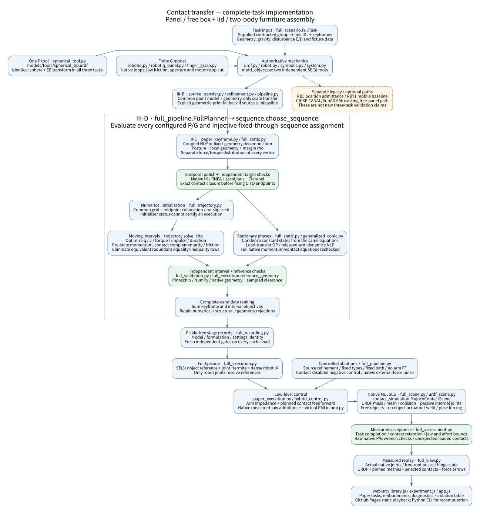

# 전체 시나리오·코드 구조·최적화·제어 검증 보고

기준일: 2026-11-12. **가구 조립, 자유 박스 개방, 패널 운반·안착·릴리스의
전체 계획과 MuJoCo 실행이 모두 통과했습니다.** 새 과제는 고정 베이스 Panda 세 대를
사용합니다. RB5-850E/RBY1/G1의 기존 구현은 별도 embodiment/모바일 항목이며,
이 세 과제의 전체 알고리즘 검증 결과와 합치지 않습니다.

[실행 결과와 비교 표 JSON](full-scenario-results.json),
[구현·실패·수치 변경 기록](full-scenario-implementation.md),
[과거 첫 lift 보고서](archive/first-lift-system-report-5ad6015.md)를 함께 제공합니다.
공개 재생 주소는 https://overjs94.github.io/Contact_contraction/ 입니다.

## 전체 구조와 데이터 흐름



[구조도 DOT 원본](diagrams/full-scenario-flow.dot).

```text
주어진 소형 contracted groups + link ID + keyframes
  → III-B source surface refinement / 명시적 기하 prior fallback
  → 위치·법선만 scale transfer; source 힘은 전달하지 않음
  → III-C robust target 자세·접촉·vertex별 힘·관절 토크·rho
  → III-D 허용 G/P × injective 팔 배정 탐색
  → IV 전체 이동 CITO + 정지 하중 전달 QP + 릴리스 동역학
  → 독립 Pinocchio/NumPy·Clarabel·URDF 충돌 형상 검사
  → 팔 impedance + 계획 접촉력 feedforward + 측정 jaw-force 제어
  → 자유 물체의 native MuJoCo 접촉 실행
  → 추종·실제 접촉·힘/토크·과제 완료 검사
  → 측정 관절·자유 root·힌지 상태의 URDF/mesh 웹 재생
```

| 책임 | 코드 |
|---|---|
| 세 과제, source/target, 배치·물성 | `full_scenario.py`, `scenarios/full_layouts.json` |
| 공통 spherical tool | `spherical_tool.py`, `models/tools/spherical_tip.urdf` |
| URDF mechanics / symbolic / native | `robot.py`, `symbolic.py`, `system.py`, `multi_object.py` |
| Source refinement·기하 전달 | `source_transfer.py`, `refinement.py`, `pipeline.py` |
| Target·고정 형상 conic 분해 | `paper_keyframe.py`, `full_static.py`, `generalized_conic.py` |
| G/P·물리 팔 배정·전이 비교 | `full_pipeline.py`, `sequence.py` |
| CITO·접촉 좌표 적분·초기화 | `trajectory.py`, `full_trajectory.py` |
| 실제 gripper·유한 힘·구동기 | `robotiq.py`, `robotiq_panel.py`, `finger_grasp.py` |
| 독립 mechanics·형상·실행 reference | `full_validation.py`, `full_execution.py` |
| 제어·가상 PMI | `paper_execution.py`, `hybrid_control.py`, `pmi.py` |
| Native scene·접촉·실제 외력 | `full_scene.py`, `contact_simulation.py`, `perturbations.py` |
| 저장·판정·웹 export | `full_recording.py`, `full_assessment.py`, `full_view.py` |
| CLI·비교·기존 계획 재실행 | `run_full_scenarios.py`, `run_controlled_ablations.py`, `replay_full_plan.py` |

파일명만 표기한 Python 모듈은 `src/contact_transfer/`, CLI는 `tools/`에 있습니다.

## 세 과제의 전체 실행

| 과제 | 키프레임 / 전이 | 선택된 도구 | 전체 실행 | 핵심 측정 결과 |
|---|---:|---|---|---|
| 가구 조립 | 10 / 9 | G / P / G | 30.392 s · 통과 | 삽입 25.001 mm, 횡오차 0.453 mm, 다리 릴리스 후 상판 지지력 3.924 N |
| 자유 박스 | 8 / 7 | G / P / G | 20.001 s · 통과 | 수동 힌지 약 60° 개방, 각도 오차 0.00141 rad, 최대 body 위치 오차 3.294 mm |
| 패널 | 9 / 8 | G / P / P | 30.381 s · 통과 | 최종 위치 오차 0.182 mm, 지그 지지력 19.62 N, 전체 공구 릴리스 |

물리 팔 배정은 세 과제 모두 `(0,1,2)`가 선택됐습니다. 허용된 후보 수는 패널 12,
박스·조립 각 24입니다. 모든 feature가 모든 도구를 허용하는 것은 아닙니다.
실제 gripper가 접근·파지할 수 있는 기능면에만 G를 허용합니다. 각 후보의 실패와
비용 가지치기는 구분해 저장합니다. 같은 물리 팔의 온라인 공구 교체는 구현하지 않았습니다.

팔의 계획 좌표는 21개입니다. Native joint 기록에는 gripper 내부 수동 기구도 포함돼,
G/P/P는 29개, G/P/G는 37개 관절 좌표를 기록합니다. 박스는 free root와 수동 hinge를
가지며 world-fixed hinge가 아닙니다. 조립의 상판과 다리는 독립 free body입니다.
물체 actuator, mocap pose 명령, 물체 weld는 없습니다. Native equality는 gripper 내부
coupling loop만 구성합니다.

모든 P는 **25 mm 반지름과 같은 EE→leading-tip 변환 `[0,0,0.165] m`, 회전 I**를
사용합니다. 과제별 접촉 법선에 맞추는 팔 자세와 tool mount bias를 구분했습니다.
P의 IK는 위치 3축과 tool axis 2축이며 축 방향 roll은 자유입니다. P는 접촉 모멘트를
전달하지 않습니다. 실제 native 관절·수동 링크·자유 root를 재생하며 gripper 개폐를
별도 애니메이션으로 덮어쓰지 않습니다.

## Source와 유형 선택의 검증 범위

소형 contracted contact의 표면 위치를 먼저 최적화하는 것이 맞습니다. 다만 현재 입력은
네트워크 출력이라고 **가정한 synthetic contracted groups**이며 학습 추론을 실행하지
않습니다. 패널 source는 길이 1/4, 질량 1/64이며 초기 자세에서 source margin이
0.44343에서 0.53207로 증가했습니다. Target 힘은 target 질량·COM·중력·friction·토크
한계로 다시 풉니다.

박스·조립의 공통 P source solve는 성공 certificate를 얻지 못했습니다. 원고의 기하
prior fallback을 명시적으로 사용했으며 성공 source로 집계하지 않습니다. 이 두 과제의
`no_source_refinement`는 전달 prior가 같아 같은 연속 계획을 재사용하고 새로운 물리
실행을 수행합니다. 따라서 source refinement의 성능 우위를 보여 주는 비교가 아닙니다.

유형 선택은 각 후보의 키프레임 비용과 전이 비용의 합을 비교합니다. 전이 비용이
비음수이므로, **이미 실현한 해당 키프레임들**의 비용만으로 최선 후보를 이길 수 없으면
전이를 생략합니다. 다른 IK/접촉점 해까지 포괄하는 전역 최적성이나 물리적 불가능의
증명은 아닙니다. 선택된 타입과 supplied fixed-type 기준이 일치하는 비교도 계획 재사용을
표시합니다. 캐시 시간과 새로운 solve 시간을 섞어 속도 우위를 주장하지 않습니다.

## Solver와 적분: 바뀐 점

주 solver는 **CasADi + IPOPT(MUMPS)** 그대로입니다. Clarabel은 고정 자세의 SOCP,
고정 형상 target 분해, 정지 하중 전달 QP와 독립 wrench 검산에 사용합니다.
SNOPT의 성능 비교 결과는 없습니다.

- 이동 구간은 16 nodes를 기본으로 하며 실패 시 32/64 nodes로 세분화합니다.
- IPOPT tolerance 1e-6, primal acceptance 2e-6, 독립 native/contact acceptance 2e-5입니다.
  구간당 각 NLP의 기본 CPU budget은 180 s입니다. 실패 iterate는 초기값으로만 사용합니다.
- P 및 일부 G finger의 scaled-tangent 변수는 같은 원형 Coulomb cone을 표현합니다.
  Huber 속도 norm을 쓰는 구간도 최종에는 원래 unsmoothed dissipation residual을 검사합니다.
- held material point가 고정된 target은 posture IK와 torque-free margin bound를 분리합니다.
  같은 rho가 모든 토크 한계와 함께 실현될 때만 분해 certificate를 인정합니다.
- 전체 q가 같은 정지 phase는 같은 전체 momentum 식을 상수 상태로 응축한 QP로 풉니다.
  이동 CITO와 정지 QP·released-arm NLP를 보고서에서 구분합니다.

모든 wrench는 moment/angular first, 반력 lambda는 **object-on-robot**입니다.

```math
M(q_k)(v_{k+1}-v_k)
=h_k[B\tau_k-b(q_k,v_k)]+\sum_i J_i(q_k)^T P_{i,k}.
```

박스·패널은 비선형 접촉 구속과 독립 관절 적분의 중복을 줄이기 위해
`contact_coordinate_midpoint`를 사용합니다. 물체 좌표와 독립 robot joints만 적분하고,
나머지 관절은 정확한 접촉 closure로 복원합니다. 7-DoF 팔의 G는 독립 관절 1개,
axis-aligned sticking P는 2개입니다. 전체 momentum·순간 no-slip·힘/토크 제한은 유지합니다.
Native Jacobian으로 선택한 dependent-joint chart의 비특이성을 별도 검사합니다.

```math
z_{k+1}=z_k+\frac{h_k}{2}(\dot z_k+\dot z_{k+1}),\qquad
q=\Psi(z),\quad g(q)=0,\quad J_g(q)v=0.
```

물체 SE(3)는 Lie-group midpoint로 갱신합니다. 조립의 수락 기록은 독립 joint/SE(3)
midpoint를 사용합니다. **원고 Eq. (17)의 poststep 식을 그대로 실행한 결과는 아닙니다.**
따라서 `full_variant_pipeline_executed`와 원문 그대로의 `full_paper_pipeline_executed`를
구분합니다. 이 변경을 전체 multibody의 passive midpoint integration이라고 부르지 않습니다.

패널 안착은 구간 사이 gap의 cubic-Hermite control ordinate를 제한하고 native 형상을
다시 검사합니다. Fixture impulse는 terminal seat부터 허용하는 restricted schedule이며,
시뮬레이터의 실제 fixture 충돌을 끄는 것은 아닙니다. 완전한 환경 접촉 모드 탐색이나
연속시간 충돌 certificate를 주장하지 않습니다.

## Low-level control 수식과 실제 활성 모드

`H`는 tool 원점의 mixed twist/wrench를 contact 좌표로 옮기며 `Jc=HJ`, `Sm=I-Sf`입니다.
Clip 전 torque controller는 다음과 같습니다.

```math
\tau=\operatorname{RNEA}(q,v,a_d)-J^T\lambda_d
+J_c^T\{S_m(K_xe+D_xe_v)+S_f(K_fe_f+K_Iz)\}
+N^T[K_q(q_d-q)+D_q(v_d-v)],\qquad
 e_f=S_fH(\lambda_m-\lambda_d).
```

`N`은 regularized dynamically consistent nullspace projector입니다. 관절 impedance는
`Kq=40`, `Dq=8`이며 토크는 URDF 한계로 clip합니다. 측정 힘 loop에는 antiwindup이 있습니다.

**이번 통과 실행은 `impedance_feedforward`, `Sf=0`입니다.** 계획 접촉력 FF와 Cartesian /
joint impedance를 사용합니다. P normal measured-force hybrid feedback도 코드에 있지만,
이번 성공 결과의 활성 모드로 설명하지 않습니다. Low-level controller는 계획 수식과
별도의 실행 계층이며 원고 수식이 hybrid control을 직접 정의한다고 주장하지 않습니다.

Robotiq jaw에는 측정 힘 feedback이 활성화됩니다. Native transmission의 aperture 미분을
사용한 virtual force-admittance를 passive midpoint로 적분하고, 두 native driver의 유한
position servo와 수동 coupling으로 실행합니다. 수동 링크에 임의 torque를 주지 않습니다.

```math
u_\theta=\max(0,-\partial a/\partial\theta)
(F^*-\max(F_L,F_R)),\quad
I_v(\omega^+-\omega)/h+D_v\bar\omega=u_\theta,\quad
\theta^+=\operatorname{clip}(\theta+h\bar\omega).
```

모델의 작동 한계는 **jaw당 40 N**입니다. 통과한 squeeze 목표는 조립 28 N, 박스 24 N,
패널 18 N이며 모델 한계와 다릅니다. 이전 박스 41.25 N / 패널 48.01 N overshoot 기록을
보존하고 목표 squeeze를 낮춰 재실행했습니다. 현재 최대 jaw force는 조립 32.10 N,
박스 35.94 N, 패널 30.03 N입니다. Native 원본 기구·mesh를 사용하지만 공급업체 전체
hardware capability나 실제 force servo calibration을 검증한 것은 아닙니다.

RB5-850E/UR 같은 position robot은 구현된 `HybridPositionAdmittance`에서

```math
M_a(v_f^+-v_f)/h+D_a\bar v_f=S_fH(\lambda_m-\lambda_d),\quad
v_c=S_m(v_d+K_xe)+S_f\bar v_f,\quad
q_{cmd}^+=\operatorname{Integrate}(q_{cmd},h\dot q_{IK})
```

를 사용합니다. 이 가상계의 PMI와 제조사 내부 위치 servo를 구분합니다. 현재 세 과제의
loaded RB5/RBY1 실행 결과는 아니며, RBY1 whole-body/mobile contact chart도 추가 검증이
필요합니다. `tele_opt` 원본은 현재 workspace에서 찾지 못했으므로 그 구현과의 동일성을
주장하지 않습니다.

## Physics·실행 gate와 비교 실험

MuJoCo timestep은 1 ms, 기본 contact는 implicitfast / elliptic cone입니다. 물체는
동역학으로만 움직입니다. 검사 항목은 task 완료, body pose, 실제 loaded contact 유지,
전체 기록의 jaw force·actuator bound, 20 Hz raw-contact wrench 검사, 의도하지 않은 loaded
collision과 sampled reference geometry입니다.

P 유지율은 **저장된 계획의 normal force >0.1 N**인 구간에서 평가합니다. Command를 끈
ablation도 원래 계획 기준을 유지합니다. 패널의 loaded 유지율은 100%이며, 하중 전달 뒤
0 N 구간까지 포함한 원래 holding 양의 접촉 비율 약 92.5–92.9%도 별도 보존합니다.
측정 contact flag를 수정하거나 사라진 접촉을 그려 넣지 않습니다. Jaw 한계는 준비·릴리스도
포함한 전체 기록에 적용합니다.

비교는 source refinement 제거, fixed types, fixed path+force allocation, arm force FF 제거,
robot/object collision 제거, 5 N 외란입니다. 각 조건 1회이며 성공률 통계나 solver 속도
개선을 주장하지 않습니다. Source/fixed-type의 동등 문제 재사용도 표시합니다.
조립에서는 fixed path도 통과했고 FF 제거는 tracking gate에서 실패했습니다. 박스에서는
FF 제거도 통과했지만 fixed path가 41.35 N jaw peak로 실패했습니다. 따라서 CITO/FF가
모든 과제의 명목 추종에서 항상 우월하다고 해석하지 않습니다.

외력은 native force API로 world +X, peak 5 N, 1초 sin-squared profile로 가합니다.
Impulse는 2.5 Ns입니다. 웹의 시작·최대·종료 event와 화살표는 이 실제 주입 기록을 씁니다.

CRISP는 별도 SDK가 필요한 선택 backend입니다. 기존 free-panel 경로와 새 세 과제의
Robotiq loop/다물체/articulated cross-validation을 구분합니다. 이번 세 과제의 검증 엔진은
MuJoCo입니다. 조립 기록은 nominal shoulder seating이며 sidewall jamming/작은 공차의
현실 적합성이나 CRISP 교차 검증까지 입증하지 않습니다.

## 재현·배포

새 optimization 전체 실행:

```sh
OPENBLAS_NUM_THREADS=1 .venv/bin/python tools/run_full_scenarios.py \
  --tasks panel box assembly --output outputs/full_scenarios --web web
```

[Compact accepted-plan bundle](../examples/recordings/full_tasks)에는 keyframe/interval
certificate와 모델·설정·원본 trace hash를 포함합니다. Raw native trace는 포함하지 않습니다.
다음 명령은 저장된 최적화 해를 현재 독립 검사로 확인한 뒤 **새 물리 실행**을 합니다.
최적화를 다시 풀었다고 표시하지 않습니다.

```sh
OPENBLAS_NUM_THREADS=1 .venv/bin/python tools/run_bundled_full_scenario.py \
  --task assembly --output outputs/bundle_replay
```

`--validate-only`로 현재 mechanics gate만 확인할 수도 있습니다. 기존 결과를 덮어쓰지 않도록
새 output 디렉터리를 사용합니다. Native gripper assets와 Python dependencies는 먼저
준비해야 합니다. 전체 trace는 해당 실행의 `native/execution.npz`, force/control log는
`native/control.json`에 저장됩니다.

GitHub Pages는 **무료 정적 재생**이며 Python 서버가 필요하지 않습니다. 새 세 과제의
브라우저 입력을 서버에서 재최적화하는 API는 추가하지 않았습니다. 새 계산은 위 CLI에서
수행합니다. 웹에서는 논문 목표, 단일 embodiment, 요소·강건성을 구분하고, 실제 URDF/mesh,
실패한 비교, 선택된 접촉·물리 팔·source fallback과 검증 범위를 표시합니다.


## 최종 비교 결과와 검증 증거

| 조건 | 가구 조립 | 자유 박스 | 패널 |
|---|---|---|---|
| Full | 통과 | 통과 | 통과 |
| Source refinement 제거 | 통과 · 동일 prior | 통과 · 동일 prior | 실패 |
| Fixed types / assignment | 통과 · 선택 후보와 동일 | 통과 · 선택 후보와 동일 | 통과 · 선택 후보와 동일 |
| Fixed path + force allocation | 통과 | 실패 · jaw 한계 | 통과 |
| Arm force FF 제거 | 실패 · 추종 | 통과 | 통과 |
| Robot/object 접촉 비활성 | 실패 | 실패 | 실패 |
| 5 N 외란 | 통과 | 통과 | 통과 |

패널의 source 제거 조건은 G/P/P 후보가 keyframe 4에서 `Restoration_Failed`로
탈락한 뒤 P/P/P를 선택했습니다. 실제 실행의 최대 위치 오차는 83.74 mm,
edge 접촉 유지율은 45.3%이며 P force 한계도 위반했습니다. 이는 해당 초기화와
solver budget에서 얻은 end-to-end 결과입니다. G/P/P의 전역 불가능이나 source
refinement만의 순수한 물리적 효과를 증명하는 결과로 해석하지 않습니다.

보존된 검사 로그는 [validation/full_tasks](validation/full_tasks)에 있습니다.
전체 Python 회귀 156개, 이후 변경부의 추가 검사 31개와 브라우저 검사 37개가
통과했습니다. 세 과제의 실제 mesh를 사용한 desktop/mobile 여섯 화면에서도
page error와 overflow가 없었습니다. Plan bundle 세 개는 별도 output 위치에서
모든 keyframe/interval의 현재 native mechanics gate를 다시 통과했습니다.

Portable assembly bundle의 별도 새 native 실행도 완료해 동일한 삽입·릴리스·힘/토크 검사를 통과했습니다. 원본 optimizer를 다시 실행한 결과로 집계하지 않습니다.
